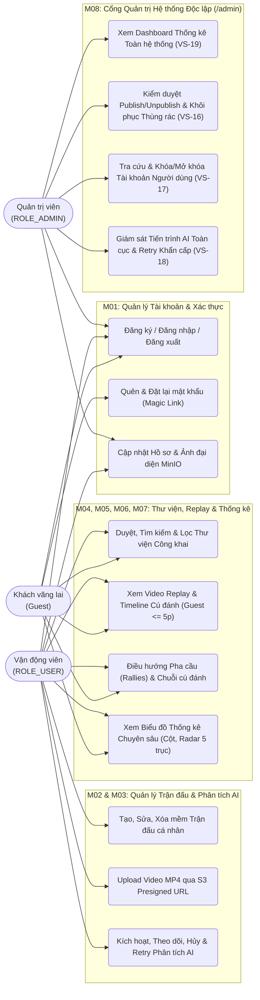
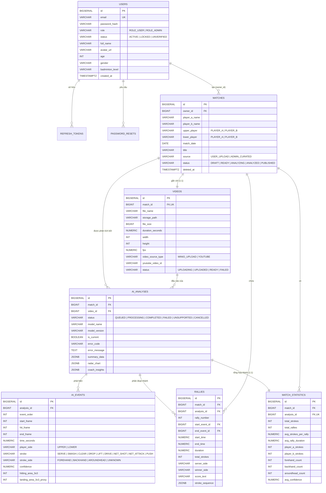
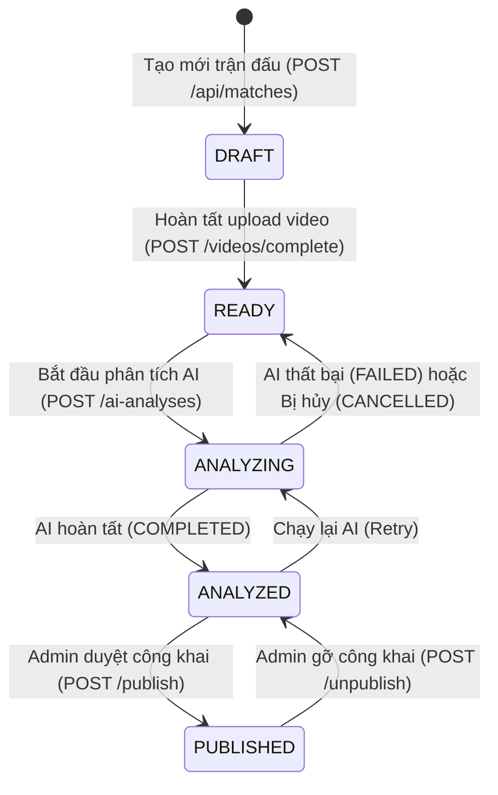

# ĐẶC TẢ YÊU CẦU PHẦN MỀM (SOFTWARE REQUIREMENTS SPECIFICATION - SRS)

**Tên dự án:** Hệ Thống Phân Tích Video Trận Đấu Cầu Lông Tự Động Bằng AI & Phát Lại Tương Tác (PBL6 Badminton – Match Analysis & Replay Platform)  
**Mã dự án:** `PBL6-BADMINTON-2026`  
**Tiêu chuẩn áp dụng:** IEEE Std 830-1998 / ISO/IEC/IEEE 29148:2018  
**Phiên bản:** `2.0 (Hoàn chỉnh toàn bộ 19 Vertical Slices VS-01 → VS-19)`  
**Ngày ban hành:** 12/10/2026  
**Ngôn ngữ giao diện hệ thống:** Tiếng Việt  

---

## MỤC LỤC
1. [Chương 1: Giới thiệu (Introduction)](#chương-1-giới-thiệu-introduction)
2. [Chương 2: Mô tả tổng quan hệ thống (Overall Description)](#chương-2-mô-tả-tổng-quan-hệ-thống-overall-description)
3. [Chương 3: Đặc tả Yêu cầu Chức năng & Use Cases (System Features & Functional Requirements)](#chương-3-đặc-tả-yêu-cầu-chức-năng--use-cases-system-features--functional-requirements)
4. [Chương 4: Đặc tả Giao diện Hệ thống (External Interface Requirements)](#chương-4-đặc-tả-giao-diện-hệ-thống-external-interface-requirements)
5. [Chương 5: Thiết kế Cơ sở Dữ liệu & Máy trạng thái (Data Model & State Machines)](#chương-5-thiết-kế-cơ-sở-dữ-liệu--máy-trạng-thái-data-model--state-machines)
6. [Chương 6: Yêu cầu Phi chức năng (Non-Functional Requirements)](#chương-6-yêu-cầu-phi-chức-năng-non-functional-requirements)
7. [Chương 7: Ma trận Truy vết Yêu cầu & Danh mục 19 Vertical Slices (RTM)](#chương-7-ma-trận-truy-vết-yêu-cầu--danh-mục-19-vertical-slices-rtm)

---

## CHƯƠNG 1: GIỚI THIỆU (INTRODUCTION)

### 1.1. Mục đích tài liệu (Purpose)
Tài liệu Đặc tả Yêu cầu Phần mềm (SRS) này mô tả toàn diện các yêu cầu nghiệp vụ, yêu cầu chức năng (Functional Requirements), yêu cầu phi chức năng (Non-Functional Requirements), kiến trúc giao tiếp, mô hình dữ liệu và ràng buộc kỹ thuật của hệ thống **PBL6 Badminton – Nền tảng Phân tích Video Cầu lông bằng AI & Xem lại Trận đấu Tương tác (BadmintonAI Pro+)**.

Tài liệu là cơ sở pháp lý và kỹ thuật thống nhất giữa:
- Nhóm phát triển Web Backend & Frontend,
- Nhóm phát triển AI Computer Vision (tích hợp qua Message Broker),
- Nhóm Kiểm thử chất lượng (QA/Tester),
- Giảng viên hướng dẫn và Hội đồng đánh giá Đồ án PBL6.

### 1.2. Quy ước ký hiệu và Thuật ngữ chuyên ngành (Conventions & Glossary)

| Thuật ngữ / Viết tắt | Giải thích chi tiết |
| :--- | :--- |
| **Match (Trận đấu)** | Một trận đấu cầu lông đơn (Singles) giữa hai vận động viên (`Player A` và `Player B`). Mỗi trận đấu liên kết 1-1 với một nguồn video duy nhất. |
| **Upper / Lower Player** | Vị trí tương đối của vận động viên trên khung hình camera góc quay cố định từ cuối sân: `UPPER` (nửa sân xa camera/phía trên màn hình) và `LOWER` (nửa sân gần camera/phía dưới màn hình). |
| **Stroke / AI Event (Cú đánh)** | Một sự kiện chạm cầu đơn lẻ được AI phát hiện kèm theo dấu thời gian (`time_seconds`), khung hình (`start_frame`, `hit_frame`, `end_frame`), loại cú đánh (`SMASH`, `CLEAR`, `DROP`, `NET_SHOT`, `NET_ATTACK`, `DRIVE`, `LIFT`, `PUSH`, `SERVE`) và tư thế tay (`FOREHAND`, `BACKHAND`, `AROUNDHEAD`). |
| **Rally (Pha cầu)** | Một chuỗi các cú đánh (`ai_events`) liên tiếp tính từ cú giao cầu (`SERVE`) hoặc bắt đầu pha bóng cho đến khi cầu chết (`SHUTTLE_DEAD`, `TIME_GAP`, `SERVICE_DETECTED`). |
| **S3 Presigned URL** | Đường dẫn có chữ ký số và thời hạn ngắn do MinIO/S3 cấp phép, giúp trình duyệt người dùng tải thẳng file video dung lượng lớn ($\le 500\text{MB}$) lên Object Storage mà không làm nghẽn băng thông của Web Backend. |
| **Guest Preview 300s** | Cơ chế giới hạn khách vãng lai (chưa đăng nhập) chỉ được xem trước tối đa 5 phút đầu ($300\text{ giây}$) của các trận đấu trong Thư viện Công khai trước khi yêu cầu đăng nhập. |
| **Soft Delete (Xóa mềm)** | Đánh dấu thời gian xóa (`deleted_at IS NOT NULL`) thay vì xóa vật lý bản ghi khỏi cơ sở dữ liệu, cho phép Quản trị viên khôi phục từ Thùng rác. |
| **VS (Vertical Slice)** | Lát cắt phát triển tính năng xuyên suốt từ Database $\rightarrow$ Backend API $\rightarrow$ Frontend UI $\rightarrow$ Kiểm thử tự động. |

### 1.3. Phạm vi dự án & Ranh giới xử lý AI (Project Scope & Core Constraint)

> [!IMPORTANT]
> **Ranh giới Phạm vi Xử lý AI (Core Constraint):**
> - Dự án Web Platform này **tuyệt đối không trực tiếp huấn luyện (train) hoặc nhúng mã nguồn mô hình học sâu thị giác máy tính (PyTorch/YOLO/TrackNet)** vào bên trong tiến trình Web Backend.
> - Tiến trình suy luận AI do bộ phận AI độc lập phát triển và giao tiếp qua hàng đợi tin nhắn **RabbitMQ**.
> - Để đảm bảo khả năng phát triển, vận hành độc lập và kiểm thử End-to-End 100% tính năng trên nền tảng Web, hệ thống trang bị:
>   1. **AI Orchestration & Mock Engine (`CoachAI+ 2.0` @Async Engine)** bên trong Backend: Mô phỏng tiến trình xử lý bất đồng bộ nhiều giai đoạn (`QUEUED` $\rightarrow$ `PROCESSING` $\rightarrow$ `COMPLETED` / `FAILED`) và nạp dữ liệu phân tích chuẩn xác từ tập dữ liệu mẫu thực tế (`match_summary.json`, `stroke_events.json`, `rallies.json`).
>   2. **AI Worker Skeleton (`ai-worker/`)**: Dịch vụ Python Consumer độc lập lắng nghe hàng đợi RabbitMQ làm cổng tích hợp chuẩn cho đội ngũ AI cắm mô hình vào.

**Trách nhiệm cốt lõi của Hệ thống:**
1. **Phân hệ Người dùng & Xác thực:** Đăng ký, đăng nhập JWT, làm mới phiên, thu hồi token khi đăng xuất, quên/đặt lại mật khẩu bằng Magic Link, quản lý hồ sơ vận động viên và ảnh đại diện (MinIO).
2. **Phân hệ Quản lý Trận đấu & Video:** Tạo trận đấu, tải lên video MP4 qua S3 Presigned URL, phát trực tuyến qua HTTP Range Requests (`206 Partial Content`) hoặc nhúng nguồn video chuẩn BWF từ YouTube.
3. **Phân hệ Điều phối Phân tích AI:** Kích hoạt phân tích bất đồng bộ (`HTTP 202 Accepted` $< 200\text{ms}$), theo dõi tiến độ thời gian thực, hủy hoặc thử lại (`Retry`) khi lỗi, lưu trữ bền vững kết quả vào PostgreSQL.
4. **Phân hệ Xem lại Tương tác & Thống kê Chuyên sâu:** Trình phát video tích hợp thanh Timeline gắn cờ màu cho từng loại cú đánh (Stroke Markers), điều hướng từng pha cầu (Rally Navigator), tự động nhảy (Seek) video đến đúng mili-giây cú đánh, và bảng thống kê đa biểu đồ (Cột dọc, Radar Ngũ giác 5 trục, Bảng định lượng).
5. **Phân hệ Thư viện Công khai:** Cho phép cộng đồng khám phá, tìm kiếm, lọc các trận đấu đã được Admin kiểm duyệt xuất bản (`PUBLISHED`), áp dụng giới hạn xem thử 5 phút đối với Khách vãng lai (`Guest`).
6. **Phân hệ Cổng Quản trị Hệ thống (`Admin Control Center`):** Giao diện quản trị tách biệt hoàn toàn với giao diện người dùng, cung cấp Dashboard biểu đồ tổng quan (Donut Chart, Gauge Chart, Horizontal Bar Chart), kiểm duyệt xuất bản/gỡ trận đấu, xóa mềm/khôi phục thùng rác, khóa/mở khóa người dùng và giám sát/Retry khẩn cấp các tiến trình AI.

---

## CHƯƠNG 2: MÔ TẢ TỔNG QUAN HỆ THỐNG (OVERALL DESCRIPTION)

### 2.1. Kiến trúc tổng thể hệ thống (System Architecture)

Hệ thống được thiết kế theo kiến trúc **Modular Monolith kết hợp Event-Driven Worker** đóng gói hoàn toàn trên hạ tầng container **Docker Compose**:

```mermaid
flowchart TB
    subgraph Client_Layer ["Tầng Giao Diện (React 18 + Vite + TypeScript + TailwindCSS)"]
        ClientUI["Giao diện Người dùng & Khách (MainLayout)\n- Trang chủ & Thư viện công khai\n- Quản lý trận đấu cá nhân\n- Trình phát Replay & Biểu đồ thống kê"]
        AdminUI["Cổng Quản trị Độc lập (AdminLayout)\n- /admin: Tổng quan & Biểu đồ hệ thống\n- /admin/matches: Kiểm duyệt & Thùng rác\n- /admin/users: Quản lý & Khóa tài khoản\n- /admin/ai-monitor: Giám sát & Retry AI"]
    end

    subgraph Backend_Layer ["Tầng Ứng Dụng Web (Spring Boot 3.2 - Java 17)"]
        Security["Spring Security + JWT Filter\n(RBAC & Kiểm tra khóa tài khoản tức thì)"]
        Controllers["Tầng REST Controllers\n(Auth, User, Match, Video, Analysis, Public, Admin)"]
        Services["Tầng Nghiệp vụ (Services)\n(AuthService, MatchService, VideoService, AnalysisService, AdminDashboardService)"]
        AsyncEngine["CoachAI+ 2.0 Async Pipeline\n(Xử lý bất đồng bộ & Tổng hợp dữ liệu)"]
    end

    subgraph Infra_Layer ["Tầng Hạ Tầng Lưu Trữ & Hàng Đợi (Docker Containers)"]
        Postgres[("PostgreSQL 15\n(Flyway V1, V2, V3)")]
        MinIO[("MinIO S3 Storage\n(Buckets: videos, avatars)")]
        RabbitMQ[["RabbitMQ 3.12\n(Queue: ai.analysis.queue)"]]
        AIWorker["Python AI Worker\n(Skeleton Consumer)"]
    end

    ClientUI -->|REST API / JSON| Security
    AdminUI -->|REST API / JSON (ROLE_ADMIN)| Security
    ClientUI -.->|PUT Presigned URL / HTTP 206 Stream| MinIO
    Security --> Controllers --> Services
    Services --> Postgres
    Services --> MinIO
    Services --> AsyncEngine
    Services --> RabbitMQ
    RabbitMQ --> AIWorker
```

### 2.2. Phân loại Người dùng và Đặc điểm (User Classes and Characteristics)

Hệ thống phục vụ 4 nhóm tác nhân (Actors) với quyền hạn được phân tách rõ ràng:

1. **Khách vãng lai (`Guest` – Chưa đăng nhập):**
   - Có thể truy cập Trang chủ, khám phá và tìm kiếm trên Thư viện Trận đấu Công khai (`/public-matches`), xem thống kê, danh sách pha cầu và xem lại video của các trận đấu `PUBLISHED` trong giới hạn **5 phút đầu tiên ($300\text{ giây}$)**.
   - Có thể thực hiện Đăng ký tài khoản, Đăng nhập, Quên mật khẩu và Đặt lại mật khẩu.
2. **Người dùng thông thường (`ROLE_USER` – Viewer):**
   - Đã đăng nhập với trạng thái tài khoản `ACTIVE`.
   - Được xem **trọn vẹn 100% thời lượng** mọi trận đấu trong Thư viện Công khai mà không bị giới hạn 5 phút.
3. **Chủ sở hữu trận đấu (`ROLE_USER` – Match Owner):**
   - Là người dùng đã tạo trận đấu cá nhân.
   - Toàn quyền thêm/sửa/xóa mềm trận đấu của mình, tải video lên MinIO, kích hoạt phân tích AI, hủy hoặc thử lại (`Retry`) phân tích AI, và xem toàn bộ kết quả phân tích của trận đấu đó (ngay cả khi trận đấu ở chế độ riêng tư).
4. **Quản trị viên hệ thống (`ROLE_ADMIN` – Administrator):**
   - Có quyền truy cập vào **Cổng Quản trị Độc lập (`/admin/*`)** tách riêng khỏi giao diện người dùng.
   - Xem biểu đồ thống kê vận hành toàn hệ thống, duyệt xuất bản (`Publish`) hoặc gỡ công khai (`Unpublish`) trận đấu, xóa mềm trận đấu vi phạm và khôi phục (`Restore`) từ thùng rác, khóa (`LOCKED`) hoặc mở khóa (`ACTIVE`) tài khoản người dùng, giám sát toàn bộ tiến trình AI và kích hoạt `Retry` khẩn cấp cho bất kỳ phiên AI nào bị lỗi.

### 2.3. Ma trận Phân quyền Truy cập (RBAC Permission Matrix)

| Nhóm Tài nguyên / Hành động | Khách (`Guest`) | Người dùng (`Viewer`) | Chủ sở hữu (`Owner`) | Quản trị viên (`ROLE_ADMIN`) |
| :--- | :---: | :---: | :---: | :---: |
| **Đăng ký, Đăng nhập, Quên/Đặt lại mật khẩu** | Cho phép | — | — | — |
| **Quản lý Hồ sơ cá nhân & Ảnh đại diện (`/users/me`)** | — | Bản thân | Bản thân | Bản thân |
| **Tạo trận đấu & Tải lên Video MP4 (S3 Presigned URL)** | — | Cho phép | Cho phép | Cho phép |
| **Xem/Sửa/Xóa mềm Trận đấu Riêng tư (`Private Match`)** | — | — | Chỉ trận của mình | Toàn bộ hệ thống |
| **Xem danh sách & Chi tiết Trận đấu Công khai (`PUBLISHED`)** | Cho phép | Cho phép | Cho phép | Cho phép |
| **Phát lại Video Trận đấu Công khai (`PUBLISHED`)** | **Giới hạn $\le 300\text{s}$** | **Toàn bộ video** | **Toàn bộ video** | **Toàn bộ video** |
| **Phát lại Video Trận đấu Riêng tư (`Private`)** | — | — | **Toàn bộ video** | **Toàn bộ video** |
| **Xem Sự kiện Cú đánh (`Events`), Pha cầu (`Rallies`) & Thống kê (`Statistics`)** | Chỉ trận `PUBLISHED` | Chỉ trận `PUBLISHED` | Trận của mình + `PUBLISHED` | Toàn bộ hệ thống |
| **Bắt đầu / Hủy / Thử lại (`Retry`) Phân tích AI** | — | — | Trên trận của mình | Trên mọi trận đấu |
| **Xuất bản (`Publish`) / Gỡ công khai (`Unpublish`) Trận đấu** | — | — | — | **Chỉ Admin** |
| **Khôi phục (`Restore`) Trận đấu đã xóa mềm từ Thùng rác** | — | — | — | **Chỉ Admin** |
| **Tra cứu Người dùng & Khóa/Mở khóa Tài khoản (`LOCKED`/`ACTIVE`)** | — | — | — | **Chỉ Admin** |
| **Xem Dashboard Quản trị & Giám sát Hàng đợi AI Toàn cục** | — | — | — | **Chỉ Admin** |

### 2.4. Môi trường Vận hành & Công nghệ Sử dụng (Operating Environment)

| Thành phần | Công nghệ & Phiên bản chuẩn |
| :--- | :--- |
| **Frontend SPA** | React `18.2`, Vite `5.x`, TypeScript `5.x`, TailwindCSS `3.4`, React Router DOM `6.x`, Axios, Video.js, Lucide Icons. |
| **Web Backend** | Java `17` (Eclipse Temurin), Spring Boot `3.2.x` (Spring Web, Spring Security, Spring Data JPA, Validation, AMQP). |
| **Cơ sở dữ liệu** | PostgreSQL `15-alpine`, quản lý phiên bản lược đồ tự động bằng **Flyway Migration** (`V1`, `V2`, `V3`). |
| **Lưu trữ Đối tượng (Object Storage)** | MinIO (`RELEASE.2024+` tương thích chuẩn AWS S3 API v4), hỗ trợ Presigned PUT/GET URL và HTTP Range Streaming. |
| **Hàng đợi Tin nhắn (Message Broker)** | RabbitMQ `3.12-management-alpine` (giao thức AMQP 0-9-1). |
| **AI Worker** | Python `3.11-slim` + thư viện `pika` (Skeleton Consumer kết nối RabbitMQ). |
| **Môi trường Triển khai** | Docker Engine & Docker Compose (`docker-compose.yml`), Nginx reverse proxy cho Frontend SPA. |

---

## CHƯƠNG 3: ĐẶC TẢ YÊU CẦU CHỨC NĂNG & USE CASES (SYSTEM FEATURES & FUNCTIONAL REQUIREMENTS)

### 3.1. Sơ đồ Tổng quan Use Case (System Use Case Diagram)



---

### 3.2. Phân hệ M01 — Quản lý Tài khoản & Xác thực (Account & Authentication Management)

#### A. Bảng Yêu cầu Chức năng M01
| Mã yêu cầu | Tên yêu cầu | Mô tả chi tiết & Quy tắc nghiệp vụ | Mức ưu tiên | Vertical Slice |
| :--- | :--- | :--- | :---: | :---: |
| **FR-M01-01** | Đăng ký tài khoản mới | Cho phép khách đăng ký bằng `email`, `password` ($\ge 8$ ký tự), `fullName`. Mật khẩu bắt buộc băm bằng `BCryptPasswordEncoder`. Tài khoản tạo mới có vai trò `ROLE_USER` và trạng thái `ACTIVE`. | Must | `VS-01` |
| **FR-M01-02** | Đăng nhập & Cấp phát JWT | Kiểm tra thông tin đăng nhập và trạng thái tài khoản (`status != LOCKED`). Trả về `accessToken` (hạn 30 phút), `refreshToken` (hạn 7 ngày, lưu hash SHA-256 trong bảng `refresh_tokens`) và thông tin người dùng. | Must | `VS-01` |
| **FR-M01-03** | Làm mới Token & Đăng xuất | Hỗ trợ cấp mới `accessToken` từ `refreshToken` hợp lệ (`POST /api/auth/refresh`) và thu hồi vĩnh viễn `refreshToken` (`revoked = true`) khi đăng xuất (`POST /api/auth/logout`). | Must | `VS-02` |
| **FR-M01-04** | Quên mật khẩu (Magic ResetToken) | Tạo mã khôi phục mật khẩu ngẫu nhiên an toàn có hiệu lực 15 phút, lưu bản băm vào bảng `password_resets` (`POST /api/auth/forgot-password`). | Must | `VS-03` |
| **FR-M01-05** | Đặt lại mật khẩu mới | Xác thực token khôi phục chưa hết hạn và chưa sử dụng (`is_used = false`), cập nhật mật khẩu mới đã băm BCrypt và đánh dấu `is_used = true` (`POST /api/auth/reset-password`). | Must | `VS-03` |
| **FR-M01-06** | Xem & Cập nhật Hồ sơ cá nhân | Người dùng xem và chỉnh sửa `fullName`, `age` ($5 \le \text{age} \le 100$), `gender` (`MALE`, `FEMALE`, `OTHER`), `badmintonLevel` (`BEGINNER`, `INTERMEDIATE`, `ADVANCED`, `PRO`). | Must | `VS-04` |
| **FR-M01-07** | Tải lên Ảnh đại diện (Avatar) | Nhận file ảnh (`image/jpeg`, `image/png`, `image/webp` $\le 5\text{MB}$) qua `POST /api/users/me/avatar`, lưu trữ lên bucket `avatars` của MinIO và cập nhật `avatar_url`. | Must | `VS-04` |

---

### 3.3. Phân hệ M02 — Quản lý Trận đấu & Lưu trữ Video (Match & Video Management)

#### A. Bảng Yêu cầu Chức năng M02
| Mã yêu cầu | Tên yêu cầu | Mô tả chi tiết & Quy tắc nghiệp vụ | Mức ưu tiên | Vertical Slice |
| :--- | :--- | :--- | :---: | :---: |
| **FR-M02-01** | Khởi tạo Trận đấu mới | Người dùng nhập `playerAName`, `playerBName`, `upperPlayer` (`PLAYER_A`/`PLAYER_B`), `lowerPlayer` (bắt buộc khác `upperPlayer`), `matchDate`, `title`, `description`. Trận đấu khởi tạo ở trạng thái `DRAFT`. | Must | `VS-05` |
| **FR-M02-02** | Xem danh sách & Chi tiết trận đấu cá nhân | Hỗ trợ phân trang (`page`, `size`) danh sách trận đấu do người dùng tạo chưa bị xóa mềm (`deleted_at IS NULL`) và xem chi tiết từng trận đấu. | Must | `VS-05` |
| **FR-M02-03** | Cập nhật & Xóa mềm Trận đấu | Chủ sở hữu hoặc Admin được cập nhật metadata trận đấu (`PUT /api/matches/{id}`) và xóa mềm (`DELETE /api/matches/{id}` $\rightarrow$ cập nhật `deleted_at = NOW()`). | Must | `VS-06` |
| **FR-M02-04** | Khởi tạo S3 Presigned Upload URL | Xác thực định dạng `video/mp4` và dung lượng $\le 524,288,000\text{ Bytes}$ ($500\text{MB}$). Sinh S3 Presigned PUT URL có hiệu lực 60 phút để Client tải thẳng file lên MinIO (`POST /api/matches/{id}/videos/upload-url`). | Must | `VS-07` |
| **FR-M02-05** | Hoàn tất Upload & Lưu Metadata Video | Kiểm tra sự tồn tại của object trên MinIO bằng `statObject`, lưu `durationSeconds` ($\le 3600\text{s}$), `width`, `height`, `fps`, chuyển trạng thái Video và Match sang `READY` (`POST /api/matches/{id}/videos/complete`). | Must | `VS-07` |
| **FR-M02-06** | Hỗ trợ Nguồn Video YouTube Chuẩn BWF | Cho phép gắn liên kết YouTube (`video_source_type = 'YOUTUBE'`, `youtube_video_id`) cho các trận đấu mẫu để đồng bộ phát lại qua YouTube IFrame API. | Should | `VS-14` / `V3` |

---

### 3.4. Phân hệ M03 — Điều phối Phân tích Video AI (AI Analysis Orchestration)

#### A. Bảng Yêu cầu Chức năng M03
| Mã yêu cầu | Tên yêu cầu | Mô tả chi tiết & Quy tắc nghiệp vụ | Mức ưu tiên | Vertical Slice |
| :--- | :--- | :--- | :---: | :---: |
| **FR-M03-01** | Yêu cầu Bắt đầu Phân tích AI (Bất đồng bộ) | Kiểm tra trận đấu đã có video `READY` và không có phiên AI nào đang chạy. Tạo bản ghi `ai_analyses` ở trạng thái `QUEUED`, cập nhật `matches.status = ANALYZING`, đẩy thông điệp lên RabbitMQ / Async Engine và **phản hồi `HTTP 202 Accepted` trong $< 200\text{ms}$**. | Must | `VS-08` |
| **FR-M03-02** | Theo dõi Tiến độ Phân tích Thời gian thực | Cung cấp API `GET /api/ai-analyses/{id}` trả về `status`, `progressPercent` ($0\text{–}100\%$), `currentStage`, `startedAt`, `completedAt`, `errorCode`, `errorMessage`. Giao diện tự động Polling mỗi $1.5\text{–}2.5\text{s}$. | Must | `VS-09` |
| **FR-M03-03** | Xử lý Hoàn tất & Lưu trữ Kết quả AI (`CoachAI+ 2.0`) | Khi phân tích thành công, hệ thống thực hiện trong cùng một giao dịch (Transaction): đặt `is_current = false` cho các phiên cũ, đặt `is_current = true` và `status = COMPLETED` cho phiên mới, lưu danh sách cú đánh vào `ai_events`, các pha cầu vào `rallies`, thống kê tổng hợp vào `match_statistics`, và chuyển `matches.status = ANALYZED`. | Must | `VS-09` |
| **FR-M03-04** | Cảnh báo Độ tin cậy thấp (`Low Confidence`) | Tự động gắn cờ `lowConfidenceWarning = true` đối với mọi sự kiện cú đánh có `confidence < 0.600` trên cả API và giao diện người dùng. | Must | `VS-11` |
| **FR-M03-05** | Hủy (`Cancel`) hoặc Thử lại (`Retry`) Phân tích AI | Chủ sở hữu hoặc Admin có thể hủy phiên đang `QUEUED`/`PROCESSING` sang `CANCELLED` (`POST .../cancel`) hoặc kích hoạt chạy lại phiên bị `FAILED`/`UNSUPPORTED`/`CANCELLED` (`POST .../retry`). | Must | `VS-10` |

---

### 3.5. Phân hệ M04, M05 & M06 — Phát lại Video, Phân tích Pha cầu & Biểu đồ Thống kê (Replay, Rallies & Statistics)

#### A. Bảng Yêu cầu Chức năng M04 – M06
| Mã yêu cầu | Tên yêu cầu | Mô tả chi tiết & Quy tắc nghiệp vụ | Mức ưu tiên | Vertical Slice |
| :--- | :--- | :--- | :---: | :---: |
| **FR-M04-01** | Phát trực tuyến Video qua HTTP Range Requests | API `GET /api/videos/{id}/stream` hỗ trợ đọc header `Range: bytes=start-end` và trả về `HTTP 206 Partial Content` từ MinIO để người dùng tua (seek) video mượt mà tới bất kỳ thời điểm nào. | Must | `VS-11` |
| **FR-M04-02** | Timeline Sự kiện AI & Cờ Cú đánh (`Stroke Markers`) | Hiển thị các vạch đánh dấu màu sắc tương ứng với từng loại cú đánh (`SMASH` đỏ, `DROP` xanh lam, `CLEAR` xanh lá, `NET_SHOT` tím...) dọc theo thanh thời gian của video. Khi bấm vào một cú đánh, trình phát nhảy tức thì đến đúng `time_seconds`. | Must | `VS-11` |
| **FR-M05-01** | Danh sách Pha cầu (`Rallies`) & Chuỗi Cú đánh | Hiển thị danh sách toàn bộ pha cầu trong trận đấu kèm điểm số (`score_text`), người giao cầu (`server_side`), người thắng pha cầu (`winner_side`), thời lượng và chuỗi thứ tự các cú đánh (`stroke_sequence`). Tự động cuộn và làm nổi bật pha cầu đang phát trên video. | Must | `VS-12` |
| **FR-M06-01** | Bảng Thống kê Chuyên sâu Đa Biểu đồ (`StatisticsDashboard`) | Cung cấp khu vực thống kê toàn chiều rộng (Full-Width) bên dưới video gồm: **4 Thẻ KPI cốt lõi**, **Biểu đồ Cột dọc (Vertical Column Chart)** tần suất các loại cú đánh, **Biểu đồ Radar Ngũ giác 5 trục (5-Axis Spider Chart)** so sánh đối đầu hai tay vợt (Tấn công, Phòng thủ, Trên lưới, Độ bền pha cầu, Khối lượng chạm cầu), **Biểu đồ Cột ngang Kỹ thuật tay** (`Forehand`, `Backhand`, `Aroundhead`) và **Bảng phân tích định lượng chi tiết**. | Must | `VS-13` |

---

### 3.6. Phân hệ M07 — Thư viện Trận đấu Công khai (Public Match Library)

#### A. Bảng Yêu cầu Chức năng M07
| Mã yêu cầu | Tên yêu cầu | Mô tả chi tiết & Quy tắc nghiệp vụ | Mức ưu tiên | Vertical Slice |
| :--- | :--- | :--- | :---: | :---: |
| **FR-M07-01** | Duyệt, Tìm kiếm & Sắp xếp Thư viện Công khai | Cung cấp tab riêng **"Thư viện công khai"** (`/public-matches`) cho phép cả Khách vãng lai và Người dùng tìm kiếm theo tên vận động viên/tiêu đề, lọc theo trình độ và sắp xếp trận đấu. | Must | `VS-14` |
| **FR-M07-02** | Giới hạn Xem thử 5 Phút (`300 giây`) cho Khách vãng lai | Trên trang xem lại trận đấu công khai (`/public-matches/{id}/replay`), nếu người xem chưa đăng nhập (`Guest`), trình phát tự động khóa ở mốc **$300\text{ giây}$ (5 phút)** và hiển thị lớp phủ (Overlay CTA) mời Đăng nhập hoặc Đăng ký tài khoản miễn phí để xem trọn vẹn toàn bộ trận đấu. | Must | `VS-15` |

---

### 3.7. Phân hệ M08 — Cổng Quản trị Hệ thống Độc lập (Admin Control Center)

> [!NOTE]
> Cổng Quản trị (`/admin/*`) sử dụng bộ khung giao diện riêng biệt hoàn toàn (`AdminLayout.tsx`) gồm Sidebar cố định bên trái và Topbar riêng, tách rời khỏi `MainLayout` của người dùng, chia thành 4 màn hình chuyên biệt không chồng chéo.

#### A. Bảng Yêu cầu Chức năng M08
| Mã yêu cầu | Tên yêu cầu | Mô tả chi tiết & Quy tắc nghiệp vụ | Mức ưu tiên | Vertical Slice |
| :--- | :--- | :--- | :---: | :---: |
| **FR-M08-01** | Dashboard Thống kê Tổng quan Hệ thống (`/admin`) | API `GET /api/admin/dashboard` cung cấp số liệu thời gian thực toàn hệ thống. Giao diện hiển thị: **4 Thẻ KPI Tổng quan**, **Biểu đồ Tròn Donut** cơ cấu trạng thái trận đấu, **Đồng hồ Bán nguyệt/Vòng tròn (Radial Gauge)** tỷ lệ AI thành công, **Biểu đồ Cột ngang** hiệu suất AI Worker & tỷ lệ tài khoản, và **Bảng Số liệu Thống kê Tổng hợp** có lối tắt điều hướng nhanh. | Must | `VS-19` |
| **FR-M08-02** | Quản lý Trận đấu, Kiểm duyệt Xuất bản & Thùng rác (`/admin/matches`) | Admin tra cứu toàn bộ trận đấu theo bộ lọc (`ALL`, `PUBLISHED`, `ANALYZED`, `DRAFT`, `DELETED`), duyệt xuất bản lên Thư viện công khai (`POST /api/admin/matches/{id}/publish`), gỡ công khai (`unpublish`), xóa mềm vi phạm (`DELETE`) hoặc khôi phục từ Thùng rác (`restore`). | Must | `VS-16` |
| **FR-M08-03** | Quản lý Người dùng & Khóa/Mở khóa Tài khoản (`/admin/users`) | Admin tìm kiếm người dùng theo email/họ tên, lọc theo trạng thái (`ACTIVE`/`LOCKED`), thực hiện khóa hoặc mở khóa tài khoản (`PUT /api/admin/users/{id}/status`). Hệ thống chặn Admin tự khóa chính mình (`400 Bad Request`) và vô hiệu hóa ngay lập tức mọi JWT đang hoạt động của tài khoản bị khóa tại `JwtAuthenticationFilter`. | Must | `VS-17` |
| **FR-M08-04** | Giám sát Tiến trình AI & Retry Khẩn cấp (`/admin/ai-monitor`) | Admin theo dõi toàn bộ các phiên phân tích AI trên hệ thống (`GET /api/admin/ai-analyses`), lọc các phiên gặp sự cố (`FAILED`/`UNSUPPORTED`/`CANCELLED`), xem mã lỗi chi tiết và kích hoạt chạy lại khẩn cấp (`POST /api/admin/ai-analyses/{id}/retry`). | Must | `VS-18` |

---

## CHƯƠNG 4: ĐẶC TẢ GIAO DIỆN HỆ THỐNG (EXTERNAL INTERFACE REQUIREMENTS)

### 4.1. Giao diện Người dùng (User Interfaces)

Toàn bộ giao diện sử dụng ngôn ngữ **Tiếng Việt**, thiết kế theo phong cách thể thao hiện đại tối màu (**Dark Sports Analytics Theme – `#070e1b` / `#0f1d35`**), chia thành 2 phân khu tách biệt:

1. **Phân khu Giao diện Người dùng & Khách (`MainLayout`):**
   - `/` (`HomePage`): Trang chủ giới thiệu nền tảng và các trận đấu nổi bật.
   - `/public-matches` (`PublicLibraryPage`): Thư viện trận đấu công khai có thanh tìm kiếm, bộ lọc nguồn phát và thẻ trận đấu trực quan.
   - `/public-matches/:id/replay` & `/matches/:id/replay` (`MatchReplayPage`): Màn hình phát lại tương tác gồm Video Player + Điều hướng Pha cầu & Sự kiện cú đánh ở hàng trên, và Bảng Thống kê Đa biểu đồ (`StatisticsDashboard`) trải rộng 12 cột ở hàng dưới.
   - `/my-matches` (`MyMatchesPage`), `/matches/create` (`CreateMatchPage`), `/matches/:id` (`MatchDetailPage`): Quản lý vòng đời trận đấu cá nhân, tải video và điều khiển phân tích AI.
   - `/profile` (`ProfilePage`), `/login`, `/register`, `/forgot-password`, `/reset-password`: Quản lý tài khoản và hồ sơ vận động viên.

2. **Phân khu Cổng Quản trị Hệ thống Độc lập (`AdminLayout`):**
   - `/admin`: Tổng quan vận hành & Biểu đồ thống kê hệ thống (`VS-19`).
   - `/admin/matches`: Kiểm duyệt Thư viện công khai & Thùng rác trận đấu (`VS-16`).
   - `/admin/users`: Quản lý người dùng & Khóa/Mở khóa tài khoản (`VS-17`).
   - `/admin/ai-monitor`: Giám sát Worker AI & Điều phối Retry khẩn cấp (`VS-18`).

### 4.2. Giao diện Truyền thông & Danh mục RESTful API (API Catalog)

#### A. Chuẩn hóa Cấu trúc Phản hồi Lỗi (`ErrorResponse` - NFR-ERR-01)
Mọi phản hồi lỗi từ Backend đều được xử lý tập trung qua `GlobalExceptionHandler` (`@RestControllerAdvice`) theo đúng cấu trúc JSON thống nhất:

```json
{
  "errorType": "VALIDATION | UPLOAD | AI | SYSTEM",
  "code": "USER_LOCKED_SELF_FORBIDDEN",
  "message": "Quản trị viên không thể tự khóa tài khoản của chính mình.",
  "details": null,
  "timestamp": "2026-10-12T13:30:00Z"
}
```

#### B. Bảng Tổng hợp Toàn bộ 31 RESTful API Endpoints của Hệ thống

| STT | Phân hệ | HTTP Method & URI | Quyền truy cập | Mã phản hồi chuẩn | Mô tả chức năng |
| :---: | :--- | :--- | :--- | :---: | :--- |
| 1 | **Auth** | `POST /api/auth/register` | Public | `201 Created` | Đăng ký tài khoản mới |
| 2 | **Auth** | `POST /api/auth/login` | Public | `200 OK` | Đăng nhập & nhận cặp JWT |
| 3 | **Auth** | `POST /api/auth/refresh` | Public | `200 OK` | Làm mới Access Token bằng Refresh Token |
| 4 | **Auth** | `POST /api/auth/logout` | User / Admin | `200 OK` | Đăng xuất & thu hồi Refresh Token |
| 5 | **Auth** | `POST /api/auth/forgot-password` | Public | `200 OK` | Yêu cầu tạo mã khôi phục mật khẩu |
| 6 | **Auth** | `POST /api/auth/reset-password` | Public | `200 OK` | Đặt lại mật khẩu mới bằng Reset Token |
| 7 | **User** | `GET /api/users/me` | User / Admin | `200 OK` | Xem thông tin hồ sơ của bản thân |
| 8 | **User** | `PUT /api/users/me` | User / Admin | `200 OK` | Cập nhật thông tin hồ sơ & trình độ cầu lông |
| 9 | **User** | `POST /api/users/me/avatar` | User / Admin | `200 OK` | Tải ảnh đại diện lên MinIO |
| 10 | **Match** | `POST /api/matches` | User / Admin | `201 Created` | Tạo mới trận đấu (`DRAFT`) |
| 11 | **Match** | `GET /api/matches` | User / Admin | `200 OK` | Danh sách trận đấu của tôi (có phân trang) |
| 12 | **Match** | `GET /api/matches/{id}` | Owner / Admin | `200 OK` | Xem chi tiết thông tin trận đấu |
| 13 | **Match** | `PUT /api/matches/{id}` | Owner / Admin | `200 OK` | Cập nhật metadata trận đấu |
| 14 | **Match** | `DELETE /api/matches/{id}` | Owner / Admin | `204 No Content` | Xóa mềm trận đấu (`deleted_at = NOW()`) |
| 15 | **Video** | `POST /api/matches/{id}/videos/upload-url` | Owner / Admin | `200 OK` | Cấp S3 Presigned PUT URL để upload video MP4 |
| 16 | **Video** | `POST /api/matches/{id}/videos/complete` | Owner / Admin | `200 OK` | Xác nhận hoàn tất upload & cập nhật metadata video |
| 17 | **Video** | `GET /api/videos/{id}/stream` | Public / Owner / Admin | `206 Partial` | Phát trực tuyến video hỗ trợ tua (Byte-Range) |
| 18 | **AI** | `POST /api/matches/{id}/ai-analyses` | Owner / Admin | `202 Accepted` | Bắt đầu phiên phân tích AI bất đồng bộ |
| 19 | **AI** | `GET /api/ai-analyses/{id}` | Owner / Admin | `200 OK` | Xem trạng thái & tiến độ phiên phân tích AI |
| 20 | **AI** | `POST /api/matches/{id}/ai-analyses/{aId}/cancel` | Owner / Admin | `200 OK` | Hủy phiên phân tích AI đang chạy |
| 21 | **AI** | `POST /api/matches/{id}/ai-analyses/{aId}/retry` | Owner / Admin | `202 Accepted` | Thử lại phiên phân tích AI bị lỗi cho chủ trận đấu |
| 22 | **Replay** | `GET /api/ai-analyses/{id}/events` | Public / Owner / Admin | `200 OK` | Lấy danh sách sự kiện cú đánh (`ai_events`) |
| 23 | **Replay** | `GET /api/ai-analyses/{id}/rallies` | Public / Owner / Admin | `200 OK` | Lấy danh sách các pha cầu (`rallies`) |
| 24 | **Replay** | `GET /api/rallies/{id}` | Public / Owner / Admin | `200 OK` | Xem chi tiết 1 pha cầu kèm chuỗi cú đánh |
| 25 | **Stats** | `GET /api/ai-analyses/{id}/statistics` | Public / Owner / Admin | `200 OK` | Lấy dữ liệu thống kê tổng hợp & biểu đồ trận đấu |
| 26 | **Public** | `GET /api/public-matches` | Public | `200 OK` | Duyệt, tìm kiếm, lọc Thư viện Trận đấu Công khai |
| 27 | **Public** | `GET /api/public-matches/{id}` | Public | `200 OK` | Xem chi tiết trận đấu công khai (kèm `previewLimitSeconds`) |
| 28 | **Admin** | `GET /api/admin/dashboard` | `ROLE_ADMIN` | `200 OK` | Lấy chỉ số & cơ cấu thống kê toàn hệ thống (`VS-19`) |
| 29 | **Admin** | `GET /api/admin/matches` (+ `publish`, `unpublish`, `DELETE`, `restore`) | `ROLE_ADMIN` | `200 OK` / `204` | Quản lý, kiểm duyệt xuất bản, xóa mềm & khôi phục trận đấu (`VS-16`) |
| 30 | **Admin** | `GET /api/admin/users` & `PUT /api/admin/users/{id}/status` | `ROLE_ADMIN` | `200 OK` | Tra cứu người dùng & Khóa/Mở khóa tài khoản (`VS-17`) |
| 31 | **Admin** | `GET /api/admin/ai-analyses` & `POST /api/admin/ai-analyses/{id}/retry` | `ROLE_ADMIN` | `200 OK` / `202` | Giám sát tiến trình AI toàn cục & Retry khẩn cấp (`VS-18`) |

---

## CHƯƠNG 5: THIẾT KẾ CƠ SỞ DỮ LIỆU & MÁY TRẠNG THÁI (DATA MODEL & STATE MACHINES)

### 5.1. Sơ đồ Thực thể Liên kết (Entity-Relationship Diagram - ERD)



### 5.2. Máy Trạng Thái Vòng Đời Trận Đấu & Phiên Phân Tích AI (State Machines)



---

## CHƯƠNG 6: YÊU CẦU PHI CHỨC NĂNG (NON-FUNCTIONAL REQUIREMENTS)

| Mã NFR | Phân nhóm | Chỉ tiêu kỹ thuật & Ràng buộc chất lượng | Giải pháp thực thi trong hệ thống |
| :--- | :--- | :--- | :--- |
| **NFR-PER-01** | Hiệu năng | Thời gian phản hồi các API truy vấn dữ liệu $\le 500\text{ms}$ (tối đa $\le 2\text{s}$). | Đánh chỉ mục Partial Index và Composite Index trên PostgreSQL (`idx_matches_public_browse`, `idx_ai_events_analysis_time`, `uq_ai_analyses_current_per_match`). |
| **NFR-PER-02** | Bất đồng bộ | **API khởi chạy AI tuyệt đối không khóa luồng HTTP**, bắt buộc trả về `HTTP 202 Accepted` trong $< 200\text{ms}$. | Sử dụng Spring `@Async` ThreadPoolExecutor kết hợp đẩy sự kiện qua RabbitMQ. |
| **NFR-VID-04** | Tải tệp lớn | Tải video dung lượng lớn ($\le 500\text{MB}$) không đi qua bộ nhớ RAM của Backend. | Sinh S3 Presigned PUT URL để trình duyệt tải trực tiếp lên MinIO. |
| **NFR-SEC-01** | Bảo mật | Mật khẩu người dùng và Token khôi phục/làm mới không bao giờ lưu dạng rõ (Plaintext). | Mật khẩu băm bằng `BCrypt`; `RefreshToken` và `PasswordResetToken` băm bằng `SHA-256`. |
| **NFR-SEC-02** | Kiểm soát truy cập tức thì | Tài khoản bị Admin chuyển sang `LOCKED` phải bị chặn truy cập ngay lập tức ở mọi request tiếp theo. | `JwtAuthenticationFilter` kiểm tra trạng thái `UserStatus.LOCKED` trực tiếp từ CSDL trước khi thiết lập `SecurityContext`. |
| **NFR-PRI-01** | Quyền riêng tư | Video riêng tư chỉ chủ sở hữu và Admin được xem; khách vãng lai chỉ xem được tối đa $300\text{ giây}$ trên trận đấu công khai. | Kiểm tra phân quyền ở cả tầng API và giới hạn thời gian phát trên `MatchReplayPage.tsx`. |
| **NFR-MNT-01** | Khả năng bảo trì | Tuân thủ nghiêm ngặt kiến trúc phân lớp `Controller -> Service -> Repository` và tách biệt giao diện `MainLayout` vs `AdminLayout`. | Kiểm soát chặt chẽ cấu trúc package Java và định tuyến React Router. |

---

## CHƯƠNG 7: MA TRẬN TRUY VẾT & DANH MỤC 19 VERTICAL SLICES ĐÃ HOÀN THÀNH (RTM)

Toàn bộ 19 Vertical Slices từ Giai đoạn 1 đến Giai đoạn 5 đã được hiện thực hóa, kiểm thử tự động và đóng gói hoàn chỉnh:

| Mã VS | Tên Vertical Slice | Các FR đáp ứng | Trạng thái |
| :---: | :--- | :--- | :---: |
| **VS-01** | Đăng ký & Đăng nhập JWT (`Register & Login`) | `FR-M01-01`, `FR-M01-02` | Hoàn thành 100% |
| **VS-02** | Làm mới Access Token & Đăng xuất (`Refresh & Logout`) | `FR-M01-03` | Hoàn thành 100% |
| **VS-03** | Quên mật khẩu & Đặt lại mật khẩu (`Forgot & Reset Password`) | `FR-M01-04`, `FR-M01-05` | Hoàn thành 100% |
| **VS-04** | Hồ sơ cá nhân & Upload Avatar MinIO (`User Profile & Avatar`) | `FR-M01-06`, `FR-M01-07` | Hoàn thành 100% |
| **VS-05** | Tạo trận đấu & Danh sách trận đấu của tôi (`Create & List Matches`) | `FR-M02-01`, `FR-M02-02` | Hoàn thành 100% |
| **VS-06** | Xem chi tiết, Cập nhật & Xóa mềm trận đấu (`Match Detail, Update & Soft Delete`) | `FR-M02-02`, `FR-M02-03` | Hoàn thành 100% |
| **VS-07** | Tải lên Video qua S3 Presigned URL & Hoàn tất Metadata (`Video Upload`) | `FR-M02-04`, `FR-M02-05` | Hoàn thành 100% |
| **VS-08** | Khởi tạo Phân tích AI Bất đồng bộ & Đẩy hàng đợi RabbitMQ (`Start AI Analysis`) | `FR-M03-01` | Hoàn thành 100% |
| **VS-09** | Tiến trình Phân tích `CoachAI+ 2.0` & Polling Trạng thái (`AI Execution & Status`) | `FR-M03-02`, `FR-M03-03` | Hoàn thành 100% |
| **VS-10** | Hủy & Thử lại Phân tích AI (`Cancel & Retry AI Analysis`) | `FR-M03-05` | Hoàn thành 100% |
| **VS-11** | Phát trực tuyến Video Range Stream & Timeline Cú đánh (`Video Stream & Events`) | `FR-M03-04`, `FR-M04-01`, `FR-M04-02` | Hoàn thành 100% |
| **VS-12** | Phân đoạn Pha cầu & Điều hướng Pha cầu (`Rallies & Sequence Navigation`) | `FR-M05-01` | Hoàn thành 100% |
| **VS-13** | Bảng Thống kê Chuyên sâu Đa Biểu đồ (`Match Statistics Dashboard`) | `FR-M06-01` | Hoàn thành 100% |
| **VS-14** | Thư viện Trận đấu Công khai, Tìm kiếm & Bộ lọc (`Public Match Library`) | `FR-M07-01` | Hoàn thành 100% |
| **VS-15** | Xem lại Trận đấu Công khai & Giới hạn Preview 5 phút cho Khách (`Guest 5-Min Limit`) | `FR-M07-02` | Hoàn thành 100% |
| **VS-16** | Quản trị Trận đấu: Duyệt Xuất bản, Gỡ công khai & Khôi phục Thùng rác (`Admin Matches`) | `FR-M08-02` | Hoàn thành 100% |
| **VS-17** | Quản trị Người dùng: Tìm kiếm & Khóa/Mở khóa Tài khoản (`Admin User Management`) | `FR-M08-03` | Hoàn thành 100% |
| **VS-18** | Giám sát Tiến trình AI Toàn cục & Retry Khẩn cấp từ Admin (`Admin AI Monitor`) | `FR-M08-04` | Hoàn thành 100% |
| **VS-19** | Dashboard Chỉ số Quản trị & Cổng Admin Độc lập (`Admin Dashboard & Portal`) | `FR-M08-01` | Hoàn thành 100% |

