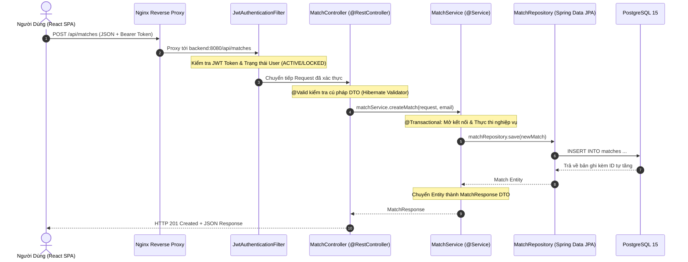
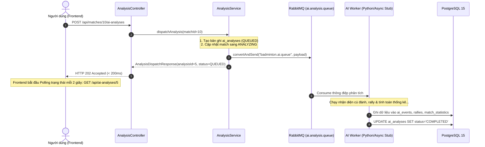

# GIÁO TRÌNH MENTOR THỰC CHIẾN: LÀM CHỦ SPRING BOOT 3 QUA DỰ ÁN PBL6 BADMINTON

> **Mục tiêu tài liệu:** Giúp bạn nắm vững bản chất kiến trúc Spring Boot 3 từ gốc rễ, hiểu rõ **tại sao lại có nó**, **nếu không có nó thì lập trình viên phải chịu cực khổ thế nào**, và mổ xẻ **từng dòng code, từng annotation, từng luồng xử lý thực tế** trong chính dự án PBL6 Badminton này để bạn tự tin bảo vệ trước Hội đồng phản biện.

---

## MỤC LỤC
1. [Phần 1: Nguồn gốc & Bản chất kiến trúc Spring (Tại sao lại có Spring?)](#phần-1-nguồn-gốc--bản-chất-kiến-trúc-spring-tại-sao-lại-có-spring)
2. [Phần 2: Kiến trúc 3 tầng (3-Tier) & Vòng đời của 1 HTTP Request](#phần-2-kiến-trúc-3-tầng-3-tier--vòng-đời-của-1-http-request)
3. [Phần 3: Bảo mật chuyên sâu với Spring Security 6 & JWT](#phần-3-bảo-mật-chuyên-sâu-với-spring-security-6--jwt)
4. [Phần 4: Xử lý Bất đồng bộ (@Async) & Message Broker (RabbitMQ)](#phần-4-xử-lý-bất-đồng-bộ-async--message-broker-rabbitmq)
5. [Phần 5: Xử lý Ngoại lệ Tập trung (@RestControllerAdvice)](#phần-5-xử-lý-ngoại-lệ-tập-trung-restcontrolleradvice)
6. [Phần 6: Quản lý Cấu hình & Tích hợp Hạ tầng (S3, MinIO)](#phần-6-quản-lý-cấu-hình--tích-hợp-hạ-tầng-s3-minio)
7. [Phần 7: Bộ 10 câu hỏi vấn đáp Hội đồng phản biện về Spring Boot](#phần-7-bộ-10-câu-hỏi-vấn-đáp-hội-đồng-phản-biện-về-spring-boot)

---

## PHẦN 1: NGUỒN GỐC & BẢN CHẤT KIẾN TRÚC SPRING (TẠI SAO LẠI CÓ SPRING?)

### 1.1. Lịch sử: Nỗi đau của lập trình viên Java trước thời kỳ Spring
Trước những năm 2003, để xây dựng ứng dụng Web hướng doanh nghiệp (Enterprise), các kỹ sư phải dùng chuẩn **J2EE (Java 2 Enterprise Edition)** với công nghệ **EJB (Enterprise Java Beans)**:
- Muốn chạy một chức năng nhỏ cũng phải cấu hình hàng chục file XML phức tạp ("XML Hell").
- Phải kế thừa các interface nặng nề của framework, khiến mã nguồn dính chặt vào công nghệ (Vendor Lock-in), gần như **không thể viết Unit Test**.
- Cần các Application Server cồng kềnh như WebLogic, WebSphere (nặng hàng GB, khởi động mất 5-10 phút).

**Nếu không có Spring Framework, để viết chức năng "Tạo Trận Đấu" (`createMatch`), bạn phải tự làm những việc sau:**
```java
// === CÁCH LÀM CỔ ĐIỂN KHÔNG CÓ SPRING (RAW SERVLET + RAW JDBC) ===
public class MatchServlet extends HttpServlet {
    private MatchService matchService;

    public void init() {
        // 1. TỰ KHỞI TẠO ĐỐI TƯỢNG (TIGHT COUPLING):
        // Nếu MatchService đổi constructor, class này bị gãy ngay!
        MatchRepository matchRepo = new MatchRepositoryImpl();
        this.matchService = new MatchServiceImpl(matchRepo);
    }

    protected void doPost(HttpServletRequest req, HttpServletResponse resp) throws IOException {
        // 2. TỰ ĐỌC BUFFER BODY THỦ CÔNG:
        StringBuilder sb = new StringBuilder();
        BufferedReader reader = req.getReader();
        String line;
        while ((line = reader.readLine()) != null) sb.append(line);
        
        // 3. TỰ PARSE JSON THỦ CÔNG & TỰ VALIDATE DỮ LIỆU:
        JSONObject json = new JSONObject(sb.toString());
        if (!json.has("playerAName") || json.getString("playerAName").isEmpty()) {
            resp.setStatus(400);
            resp.getWriter().write("{\"error\": \"Player A is required\"}");
            return;
        }

        // 4. TỰ QUẢN LÝ DATABASE CONNECTION & TRANSACTION:
        Connection conn = null;
        try {
            conn = DriverManager.getConnection("jdbc:postgresql://localhost:5432/badminton_db", "user", "pass");
            conn.setAutoCommit(false); // Bắt đầu Transaction thủ công

            PreparedStatement stmt = conn.prepareStatement("INSERT INTO matches (player_a_name, ...) VALUES (?)");
            stmt.setString(1, json.getString("playerAName"));
            stmt.executeUpdate();

            conn.commit(); // Tự commit
        } catch (SQLException e) {
            if (conn != null) conn.rollback(); // Tự rollback khi lỗi
            resp.setStatus(500);
        } finally {
            if (conn != null) conn.close(); // Tự đóng connection (quên đóng là sập server)
        }
    }
}
```

### 1.2. Cuộc cách mạng mang tên Spring: IoC & DI
Spring Framework ra đời với triết lý: **Lập trình viên chỉ cần tập trung vào Nghiệp vụ (Business Logic), toàn bộ việc quản lý vòng đời đối tượng, kết nối CSDL, bảo mật, transaction hãy để Spring lo.**

Hai khái niệm nền tảng mà bạn bắt buộc phải hiểu:
1. **Inversion of Control (IoC - Đảo ngược quyền điều khiển):**
   - Bình thường (cách cũ): Class A tự `new Class B()` để sử dụng $\rightarrow$ Class A nắm quyền kiểm soát việc sinh ra Class B.
   - Với IoC: Bạn không tự `new` bất cứ Service hay Repository nào nữa. **Spring IoC Container** sẽ tạo sẵn các đối tượng đó (gọi là các **Spring Beans**) và giữ trong một chiếc "kho".
2. **Dependency Injection (DI - Tiêm phụ thuộc):**
   - Khi Class A cần Class B, Spring Container sẽ tự động "tiêm" (inject) instance của Class B vào Class A thông qua Constructor.

#### Code thực tế trong dự án PBL6 Badminton:
Tại [`MatchController.java`](file:///d:/DUT/HK1_Nam4_2026-2027/PBL6/PBL6_code/backend/src/main/java/com/badminton/controller/MatchController.java#L16-L22):
```java
@RestController
@RequestMapping("/api/matches")
@RequiredArgsConstructor // Lombok tự động tạo constructor chứa tham số final matchService
public class MatchController {

    private final MatchService matchService; // <--- KHÔNG DÙNG new MatchService()!
    // Spring Container tự tìm Bean MatchService đã khởi tạo sẵn để tiêm vào đây!
```

> **Hội đồng hỏi:** *"Tại sao em không dùng `@Autowired` trên thuộc tính mà dùng Constructor Injection thông qua `@RequiredArgsConstructor`?"*  
> **Bạn trả lời:** *"Dạ, Field Injection (`@Autowired private MatchService matchService`) đã bị coi là Bad Practice vì gây khó khăn khi viết Unit Test (không thể truyền mock bằng tay) và dễ ẩn giấu lỗi vòng lặp phụ thuộc (Circular Dependency). Constructor Injection là chuẩn khuyến nghị của Spring: các dependency được khai báo `final`, đảm bảo tính bất biến (Immutability) và đảm bảo class không thể được khởi tạo nếu thiếu dependency."*

---

## PHẦN 2: KIẾN TRÚC 3 TẦNG (3-TIER) & VÒNG ĐỜI CỦA 1 HTTP REQUEST

Dự án tuân thủ nghiêm ngặt quy tắc **NFR-MNT-01: Controller $\rightarrow$ Service $\rightarrow$ Repository**.



### 2.1. Phân tích Từng Tầng qua Code Dự Án Thực Tế

#### A. Tầng 1: Web / Controller ([`MatchController.java`](file:///d:/DUT/HK1_Nam4_2026-2027/PBL6/PBL6_code/backend/src/main/java/com/badminton/controller/MatchController.java))
Nhiệm vụ: **Chỉ làm việc với giao thức HTTP** (đón request, parse tham số, kiểm tra tính hợp lệ của DTO, trả mã HTTP Status). **Tuyệt đối không viết logic tính toán hay query SQL ở đây.**

```java
@PostMapping
public ResponseEntity<MatchResponse> createMatch(
        @AuthenticationPrincipal String email,        // [1] Lấy email từ Security Context đã xác thực
        @Valid @RequestBody CreateMatchRequest request // [2] Tự động parse JSON thành Java Object & validate
) {
    MatchResponse response = matchService.createMatch(request, email); // [3] Gọi sang tầng Service
    return ResponseEntity.status(HttpStatus.CREATED).body(response);   // [4] Trả về HTTP 201 Created
}
```
* **`@RestController`**: Kết hợp giữa `@Controller` và `@ResponseBody`. Báo cho Spring biết kết quả trả về của hàm sẽ được tự động tuần tự hóa (serialize) thành JSON thông qua thư viện Jackson để đẩy vào HTTP Response Body.
* **`@Valid`**: Kích hoạt cơ chế Hibernate Bean Validation trên DTO [`CreateMatchRequest`](file:///d:/DUT/HK1_Nam4_2026-2027/PBL6/PBL6_code/backend/src/main/java/com/badminton/dto/match/CreateMatchRequest.java). Nếu `playerAName` bị trống (`@NotBlank`), Spring sẽ ngắt request ngay lập tức và ném ra `MethodArgumentNotValidException` mà không cần bạn phải viết lệnh `if (name == null)`.

#### B. Tầng 2: Nghiệp Vụ / Service ([`MatchService.java`](file:///d:/DUT/HK1_Nam4_2026-2027/PBL6/PBL6_code/backend/src/main/java/com/badminton/service/MatchService.java))
Nhiệm vụ: **Nơi chứa trái tim của ứng dụng** (Business Logic, tính toán, kiểm tra nghiệp vụ, điều phối giao dịch CSDL).

```java
@Service
@RequiredArgsConstructor
public class MatchService {
    private final MatchRepository matchRepository;
    private final UserRepository userRepository;

    @Transactional // [1] Quản lý Giao dịch CSDL (Transaction)
    public MatchResponse createMatch(CreateMatchRequest request, String userEmail) {
        // [2] Kiểm tra nghiệp vụ: Người dùng có tồn tại không?
        User user = userRepository.findByEmail(userEmail)
                .orElseThrow(() -> new ApiException(HttpStatus.NOT_FOUND, ErrorType.VALIDATION, 
                        "USER_NOT_FOUND", "Người dùng không tồn tại"));

        // [3] Kiểm tra nghiệp vụ: Hai người chơi có đứng cùng 1 nửa sân không?
        if (request.getUpperPlayer() == request.getLowerPlayer()) {
            throw new ApiException(HttpStatus.BAD_REQUEST, ErrorType.VALIDATION, 
                    "INVALID_PLAYER_POSITION", "Vị trí nửa sân trên và dưới không thể là cùng một người chơi");
        }

        // [4] Ánh xạ dữ liệu sang Entity bằng Builder Pattern
        Match match = Match.builder()
                .owner(user)
                .playerAName(request.getPlayerAName().trim())
                .playerBName(request.getPlayerBName().trim())
                .upperPlayer(request.getUpperPlayer().name())
                .lowerPlayer(request.getLowerPlayer().name())
                .matchDate(request.getMatchDate() != null ? request.getMatchDate() : LocalDate.now())
                .title(request.getTitle())
                .description(request.getDescription())
                .status("DRAFT") // Trận đấu mới luôn ở trạng thái bản nháp
                .source("USER_UPLOAD")
                .build();

        Match savedMatch = matchRepository.save(match);
        return MatchResponse.fromEntity(savedMatch); // Trả về DTO
    }
}
```

* **Annotation `@Transactional` làm nhiệm vụ gì?**
  - Mở một Transaction trong PostgreSQL trước khi hàm chạy.
  - Nếu toàn bộ hàm chạy êm xuôi: Tự động `COMMIT`.
  - Nếu có bất kỳ `RuntimeException` nào xảy ra (ví dụ ném `ApiException`): Tự động `ROLLBACK` toàn bộ các câu lệnh INSERT/UPDATE trước đó về trạng thái ban đầu, bảo vệ tính toàn vẹn dữ liệu (ACID).
  - Kích hoạt cơ chế **Dirty Checking** của Hibernate: Nếu bạn lấy một Entity ra và gọi `match.setStatus("READY")`, khi kết thúc hàm `@Transactional`, Hibernate tự phát hiện đối tượng đã bị sửa đổi và tự sinh lệnh `UPDATE matches SET status = ...` mà không cần bạn phải gọi `repository.save()`.

#### C. Tầng 3: Truy Cập Dữ Liệu / Repository ([`MatchRepository.java`](file:///d:/DUT/HK1_Nam4_2026-2027/PBL6/PBL6_code/backend/src/main/java/com/badminton/repository/MatchRepository.java))
Nhiệm vụ: **Giao tiếp trực tiếp với cơ sở dữ liệu PostgreSQL**.

```java
@Repository
public interface MatchRepository extends JpaRepository<Match, Long> {

    // 1. Spring Data JPA Tự Động Sinh SQL theo tên hàm (Derived Query Method):
    // SQL sinh ra: SELECT * FROM matches WHERE owner_id = ? AND deleted_at IS NULL ORDER BY created_at DESC
    Page<Match> findByOwnerIdAndDeletedAtIsNullOrderByCreatedAtDesc(Long ownerId, Pageable pageable);

    // 2. Viết câu truy vấn tối ưu bằng JPQL (Java Persistence Query Language):
    @Query("SELECT m FROM Match m WHERE m.status = 'PUBLISHED' AND m.deletedAt IS NULL AND " +
           "(LOWER(m.playerAName) LIKE LOWER(CONCAT('%', :kw, '%')) OR " +
           " LOWER(m.playerBName) LIKE LOWER(CONCAT('%', :kw, '%')) OR " +
           " LOWER(m.title) LIKE LOWER(CONCAT('%', :kw, '%')))")
    Page<Match> searchPublicMatches(@Param("kw") String keyword, Pageable pageable);
}
```
* **Tại sao không cần viết file implementation (`MatchRepositoryImpl`)?**  
  Spring Data JPA sử dụng kỹ thuật **Dynamic Proxy** khi ứng dụng khởi động. Nó đọc tên hàm `findByOwnerIdAndDeletedAtIsNullOrderByCreatedAtDesc`, tự động phân tích cú pháp (parse AST) và sinh ra class bytecode thực thi câu lệnh SQL trực tiếp xuống PostgreSQL.

---

## PHẦN 3: BẢO MẬT CHUYÊN SÂU VỚI SPRING SECURITY 6 & JWT

### 3.1. Tại sao dùng Stateless JWT thay vì Session/Cookie truyền thống?
* **Session/Cookie (Stateful):** Mỗi khi user đăng nhập, Server phải lưu một bản ghi Session vào RAM. Khi hệ thống có hàng chục ngàn người dùng hoặc khi bạn mở rộng hệ thống thành 3-4 container backend (Load Balancing), các container không chia sẻ RAM với nhau, khiến user bị văng đăng nhập liên tục.
* **JWT (Stateless):** Sau khi đăng nhập, Server ký số một chuỗi mã hóa (`Header.Payload.Signature`) và giao cho Client tự giữ (ở `localStorage`). Server **hoàn toàn không lưu session trong RAM**. Khi Client gửi request kèm `Authorization: Bearer <token>`, Server chỉ cần giải mã chữ ký bằng `SECRET_KEY` là biết ngay user này là ai.

### 3.2. Mổ xẻ Chi tiết Luồng Bảo Mật Thực Tế

#### A. Cấu hình Filter Chain ([`SecurityConfig.java`](file:///d:/DUT/HK1_Nam4_2026-2027/PBL6/PBL6_code/backend/src/main/java/com/badminton/config/SecurityConfig.java))
```java
@Configuration
@EnableWebSecurity
@EnableMethodSecurity
@RequiredArgsConstructor
public class SecurityConfig {

    private final JwtAuthenticationFilter jwtAuthenticationFilter;

    @Bean
    public PasswordEncoder passwordEncoder() {
        return new BCryptPasswordEncoder(); // Mã hóa mật khẩu an toàn với muối (Salt) ngẫu nhiên
    }

    @Bean
    public SecurityFilterChain securityFilterChain(HttpSecurity http) throws Exception {
        http
            // 1. Tắt CSRF vì ứng dụng dùng Stateless REST API + JWT (không dùng Cookie nên không bị tấn công CSRF)
            .csrf(AbstractHttpConfigurer::disable)
            // 2. Báo cho Spring Security không bao giờ tạo HTTP Session trong RAM
            .sessionManagement(session -> session.sessionCreationPolicy(SessionCreationPolicy.STATELESS))
            // 3. Quy tắc phân quyền truy cập endpoint
            .authorizeHttpRequests(auth -> auth
                .requestMatchers("/api/health", "/api/auth/**", "/api/public-matches/**").permitAll()
                .requestMatchers("/api/videos/*/stream").permitAll() // Hỗ trợ Guest xem preview 5 phút
                .requestMatchers("/api/admin/**").hasRole("ADMIN")   // Bắt buộc role ROLE_ADMIN
                .anyRequest().authenticated()                         // Mọi API khác phải có Token hợp lệ
            )
            // 4. Cắm Filter kiểm tra JWT của ta đứng TRƯỚC filter mặc định UsernamePasswordAuthenticationFilter
            .addFilterBefore(jwtAuthenticationFilter, UsernamePasswordAuthenticationFilter.class);

        return http.build();
    }
}
```

#### B. Bộ lọc kiểm tra Token & Chặn tài khoản bị khóa tức thì ([`JwtAuthenticationFilter.java`](file:///d:/DUT/HK1_Nam4_2026-2027/PBL6/PBL6_code/backend/src/main/java/com/badminton/config/JwtAuthenticationFilter.java))
Lớp này kế thừa `OncePerRequestFilter` để đảm bảo nó chỉ chạy đúng 1 lần cho mỗi HTTP Request gửi đến:

```java
@Override
protected void doFilterInternal(HttpServletRequest request, HttpServletResponse response, FilterChain filterChain)
        throws ServletException, IOException {
    // 1. Trích xuất chuỗi JWT từ Header "Authorization: Bearer eyJhbGciOi..."
    String jwt = extractJwtFromRequest(request);

    // 2. Xác thực chữ ký số và thời hạn của token
    if (StringUtils.hasText(jwt) && jwtTokenProvider.validateToken(jwt)) {
        String email = jwtTokenProvider.getEmailFromToken(jwt);
        String role = jwtTokenProvider.getRoleFromToken(jwt);

        // 3. TÍNH NĂNG BẢO MẬT QUAN TRỌNG (VS-17):
        // Mặc dù JWT chưa hết hạn, nhưng nếu Admin vừa bấm KHÓA tài khoản trong DB,
        // hệ thống phải chặn ngay lập tức, trả mã HTTP 403 Forbidden!
        Optional<User> userOpt = userRepository.findByEmail(email);
        if (userOpt.isPresent() && "LOCKED".equalsIgnoreCase(userOpt.get().getStatus())) {
            response.setStatus(HttpServletResponse.SC_FORBIDDEN);
            response.setContentType("application/json;charset=UTF-8");
            response.getWriter().write("{\"errorType\":\"SYSTEM\",\"code\":\"AUTH_ACCOUNT_LOCKED\",\"message\":\"Tài khoản của bạn đã bị khóa bởi quản trị viên.\"}");
            return; // Dừng chuỗi filter ngay, không cho request đi tiếp
        }

        // 4. Nếu hợp lệ: Đưa thông tin danh tính vào SecurityContextHolder của Thread hiện tại
        SimpleGrantedAuthority authority = new SimpleGrantedAuthority(role);
        UsernamePasswordAuthenticationToken authentication = new UsernamePasswordAuthenticationToken(
                email, null, Collections.singletonList(authority)
        );
        SecurityContextHolder.getContext().setAuthentication(authentication);
    }

    // 5. Cho phép request đi tiếp vào Controller
    filterChain.doFilter(request, response);
}
```

---

## PHẦN 4: XỬ LÝ BẤT ĐỒNG BỘ (@ASYNC) & MESSAGE BROKER (RABBITMQ)

### 4.1. Vấn đề Non-blocking (Tại sao phân tích AI phải chạy bất đồng bộ?)
- Quá trình phân tích một video trận đấu cầu lông (cắt frame, phát hiện tiếp xúc cầu, phân loại cú đánh bằng mô hình AI) thường kéo dài từ **30 giây đến vài phút**.
- Nếu bạn xử lý đồng bộ trong HTTP Request: Trình duyệt của người dùng sẽ bị xoay vòng loading, sau 30-60 giây HTTP connection sẽ bị **Timeout (504 Gateway Timeout)** và Tomcat Server bị cạn kiệt luồng (Thread Exhaustion) dẫn đến sập toàn bộ trang web.
- **Giải pháp:** Tuân thủ chuẩn **NFR-PER-02**: Controller tiếp nhận yêu cầu $\rightarrow$ Đổi trạng thái trận đấu thành `ANALYZING` $\rightarrow$ Trả ngay mã **`HTTP 202 Accepted` trong $< 200\text{ms}$** $\rightarrow$ Đẩy việc nặng cho **RabbitMQ / ThreadPool ngầm** xử lý.



### 4.2. Code Thực Tế trong Dự Án ([`AnalysisService.java`](file:///d:/DUT/HK1_Nam4_2026-2027/PBL6/PBL6_code/backend/src/main/java/com/badminton/service/AnalysisService.java#L40-L100))
```java
@Transactional
public AnalysisDispatchResponse dispatchAnalysis(Long matchId, String userEmail) {
    // 1. Kiểm tra quyền sở hữu và video đã READY chưa
    // ...
    // 2. Tạo bản ghi phiên phân tích mới với trạng thái ban đầu là QUEUED
    AiAnalysis analysis = AiAnalysis.builder()
            .match(match)
            .video(video)
            .status("QUEUED")
            .modelName("CoachAI+")
            .modelVersion("2.0_pbl6_coachai")
            .isCurrent(true)
            .build();
    AiAnalysis savedAnalysis = aiAnalysisRepository.saveAndFlush(analysis);

    match.setStatus("ANALYZING");
    matchRepository.saveAndFlush(match);

    // 3. ĐẨY TASK VÀO HÀNG ĐỢI RABBITMQ (AMQP):
    boolean sentToRabbit = false;
    try {
        Map<String, Object> job = Map.of(
            "analysisId", savedAnalysis.getId(),
            "matchId", matchId,
            "videoStoragePath", video.getStoragePath()
        );
        String payload = new ObjectMapper().writeValueAsString(job);
        // Gửi thông điệp vào RabbitMQ Exchange
        rabbitTemplate.convertAndSend(RabbitMQConfig.EXCHANGE_NAME, RabbitMQConfig.ROUTING_KEY, payload);
        sentToRabbit = true;
    } catch (Exception e) {
        log.warn("Không thể gửi lên RabbitMQ ({}), fallback sang MockAiEngine nội bộ.", e.getMessage());
    }

    // 4. Nếu không có RabbitMQ ngoài: Chạy luồng giả lập bằng @Async Engine nội bộ
    if (!sentToRabbit) {
        mockAiEngineService.runMockAnalysis(savedAnalysis.getId());
    }

    // 5. Trả ngay phản hồi cho người dùng, KHÔNG CHỜ PHÂN TÍCH XONG!
    return AnalysisDispatchResponse.builder()
            .analysisId(savedAnalysis.getId())
            .matchId(matchId)
            .status("QUEUED")
            .message("Yêu cầu phân tích AI đã được tiếp nhận thành công.")
            .build();
}
```

---

## PHẦN 5: XỬ LÝ NGOẠI LỆ TẬP TRUNG (@RESTCONTROLLERADVICE)

### 5.1. Tại sao phải xử lý ngoại lệ tập trung?
- Nếu không có nó: Ở mỗi Controller bạn đều phải viết `try { ... } catch (Exception e) { ... }`, dẫn đến hàng trăm dòng code lặp lại, và mỗi lập trình viên lại trả về một format lỗi khác nhau (`{ "err": "..." }`, `{ "msg": "..." }`, `{ "error_code": 123 }`).
- **Giải pháp:** Sử dụng **AOP (Aspect-Oriented Programming)** thông qua annotation `@RestControllerAdvice`. Mọi Exception ném ra ở bất cứ đâu (Controller, Service, Repository) đều bị "chặn bắt" tại một nơi duy nhất và chuyển hóa thành định dạng JSON chuẩn theo đặc tả **NFR-ERR-01**.

### 5.2. Code Thực Tế ([`GlobalExceptionHandler.java`](file:///d:/DUT/HK1_Nam4_2026-2027/PBL6/PBL6_code/backend/src/main/java/com/badminton/common/exception/GlobalExceptionHandler.java))
```java
@RestControllerAdvice
@Slf4j
public class GlobalExceptionHandler {

    // 1. Bắt ngoại lệ nghiệp vụ do chính ta chủ động ném ra trong Service (ApiException)
    @ExceptionHandler(ApiException.class)
    public ResponseEntity<ErrorResponse> handleApiException(ApiException ex) {
        ErrorResponse errorResponse = ErrorResponse.builder()
                .errorType(ex.getErrorType())
                .code(ex.getErrorCode())
                .message(ex.getMessage())
                .timestamp(Instant.now())
                .build();
        return ResponseEntity.status(ex.getStatus()).body(errorResponse);
    }

    // 2. Bắt lỗi Validation khi client gửi sai body (@Valid DTO)
    @ExceptionHandler(MethodArgumentNotValidException.class)
    public ResponseEntity<ErrorResponse> handleValidationException(MethodArgumentNotValidException ex) {
        Map<String, String> errors = new HashMap<>();
        ex.getBindingResult().getFieldErrors().forEach(error -> 
            errors.put(error.getField(), error.getDefaultMessage())
        );

        ErrorResponse errorResponse = ErrorResponse.builder()
                .errorType(ErrorType.VALIDATION)
                .code("VALIDATION_FAILED")
                .message("Dữ liệu đầu vào không hợp lệ")
                .details(errors)
                .timestamp(Instant.now())
                .build();
        return ResponseEntity.badRequest().body(errorResponse);
    }
}
```

Format JSON trả về cho Client luôn chuẩn hóa 100%:
```json
{
  "errorType": "VALIDATION",
  "code": "VALIDATION_FAILED",
  "message": "Dữ liệu đầu vào không hợp lệ",
  "details": {
    "playerAName": "Tên người chơi A không được để trống",
    "password": "Mật khẩu phải từ 8 ký tự trở lên"
  },
  "timestamp": "2026-10-14T08:00:00Z"
}
```

---

## PHẦN 6: QUẢN LÝ CẤU HÌNH & TÍCH HỢP HẠ TẦNG (S3, MINIO)

### 6.1. Quản lý Cấu hình bằng Java 17 Record & `@ConfigurationProperties`
Thay vì rải rác `@Value("${storage.s3.endpoint}")` khắp nơi, dự án đóng gói thành Record bất biến:

```java
// S3Properties.java
@ConfigurationProperties(prefix = "storage.s3")
public record S3Properties(
        String endpoint,
        String publicUrl,
        String accessKey,
        String secretKey,
        String region,
        boolean pathStyleAccess,
        Bucket bucket
) {
    public record Bucket(String videos, String avatars) {}
}
```
Spring Boot tự động ánh xạ các biến môi trường từ Docker Compose (`S3_ENDPOINT`, `S3_ACCESS_KEY`, ...) vào Record này với đầy đủ Type-safety và tự động kiểm tra cú pháp khi khởi động.

### 6.2. Tự động hóa Vòng Đời Ứng Dụng ([`S3BucketInitializer.java`](file:///d:/DUT/HK1_Nam4_2026-2027/PBL6/PBL6_code/backend/src/main/java/com/badminton/config/S3BucketInitializer.java))
Khi hệ thống chạy lần đầu tiên trên Docker với một volume MinIO rỗng, 2 bucket `badminton-videos` và `badminton-avatars` chưa hề tồn tại. Thay vì bắt người dùng phải vào MinIO Console tạo bằng tay:

```java
@Component
public class S3BucketInitializer {
    private final S3Client s3Client;
    private final S3Properties s3Properties;

    // Lắng nghe sự kiện Spring Boot đã sẵn sàng (ApplicationReadyEvent)
    @EventListener(ApplicationReadyEvent.class)
    public void initializeBuckets() {
        ensureBucketExists(s3Properties.bucket().videos(), false);
        ensureBucketExists(s3Properties.bucket().avatars(), true); // Bật public read cho avatar
    }

    private void ensureBucketExists(String bucketName, boolean publicRead) {
        try {
            s3Client.headBucket(HeadBucketRequest.builder().bucket(bucketName).build());
        } catch (NoSuchBucketException | S3Exception e) {
            // Nếu chưa có: Tự động gọi S3 API tạo mới ngay lập tức
            s3Client.createBucket(CreateBucketRequest.builder().bucket(bucketName).build());
        }
    }
}
```

---

## PHẦN 7: BỘ 10 CÂU HỎI VẤN ĐÁP HỘI ĐỒNG PHẢN BIỆN VỀ SPRING BOOT

Dưới đây là 10 câu hỏi cốt lõi mà Thầy/Cô trong Hội đồng chấm Đồ án rất hay hỏi, kèm gợi ý câu trả lời giúp bạn ghi điểm tuyệt đối:

### Câu 1: Em hãy giải thích vòng đời của một Bean trong Spring Boot?
* **Trả lời:**  
  *"Dạ thưa Thầy/Cô, vòng đời của một Spring Bean trải qua các giai đoạn:  
  1. **Khởi tạo (Instantiation):** Spring đọc các annotation (`@Component`, `@Service`, `@Bean`) và khởi tạo instance thông qua Reflection/Constructor.  
  2. **Tiêm phụ thuộc (Populate Properties / DI):** Spring tiêm các dependency cần thiết vào bean.  
  3. **Khởi tạo nâng cao (Initialization):** Các hàm gắn `@PostConstruct` hoặc phương thức trong `InitializingBean` được kích hoạt.  
  4. **Sử dụng (In Use):** Bean nằm trong ApplicationContext phục vụ các request của ứng dụng (mặc định Scope là Singleton).  
  5. **Hủy (Destruction):** Khi ứng dụng tắt (Shutdown Hook), Spring gọi các hàm gắn `@PreDestroy` để dọn dẹp tài nguyên (đóng connection pool, ngắt thread)."*

### Câu 2: Sự khác nhau giữa `@Component`, `@Service`, và `@Repository` là gì?
* **Trả lời:**  
  *"Dạ, về mặt kỹ thuật, `@Service` và `@Repository` đều là meta-annotation kế thừa từ `@Component`. Tuy nhiên chúng được phân chia để thể hiện rõ ngữ nghĩa trong kiến trúc Domain-Driven/Layered:  
  - `@Component`: Đánh dấu một class thông thường là Spring Bean.  
  - `@Service`: Đánh dấu tầng chứa Business Logic.  
  - `@Repository`: Đánh dấu tầng DAO/Truy cập CSDL. Điểm đặc biệt của `@Repository` là nó có sẵn cơ chế tự động chuyển đổi các Exception cấp thấp của JDBC/SQL thành hệ thống ngoại lệ thống nhất `DataAccessException` của Spring."*

### Câu 3: Annotation `@Transactional` hoạt động dưới nền tảng như thế nào?
* **Trả lời:**  
  *"Dạ, `@Transactional` hoạt động dựa trên cơ chế **Spring AOP (Aspect-Oriented Programming)** và **Dynamic Proxy**:  
  Khi ta gọi một method có `@Transactional`, Spring không gọi trực tiếp class đó mà gọi qua một Proxy bao bọc bên ngoài. Proxy này sẽ mở kết nối CSDL, gọi `connection.setAutoCommit(false)`, sau đó mới gọi hàm của ta. Nếu hàm thực thi thành công, Proxy gọi `commit()`. Nếu hàm ném ra `RuntimeException`, Proxy sẽ gọi `rollback()` để hoàn tác dữ liệu."*

### Câu 4: Tại sao trong hàm `login`, em không lưu token vào CSDL mà lại có bảng `refresh_tokens`?
* **Trả lời:**  
  *"Dạ, Access Token có thời hạn ngắn (30 phút) và là Stateless JWT nên không lưu DB để đảm bảo tốc độ xác thực cực nhanh ở mỗi request.  
  Tuy nhiên, Refresh Token có thời hạn dài (7 ngày). Để đảm bảo an toàn nếu người dùng bị lộ token hoặc khi người dùng bấm Đăng Xuất (`Logout`), hệ thống bắt buộc phải lưu hash của Refresh Token vào bảng `refresh_tokens`. Khi đăng xuất, ta cập nhật `revoked = true` để vô hiệu hóa token đó vĩnh viễn, ngăn chặn kẻ xấu lợi dụng Refresh Token cũ để lấy Access Token mới."*

### Câu 5: Trong dự án, em dùng S3 Presigned URL để upload video thay vì viết một API nhận `MultipartFile`. Tại sao lại làm vậy?
* **Trả lời:**  
  *"Dạ, đây là quyết định kiến trúc theo yêu cầu **NFR-VID-04**:  
  Video trận đấu cầu lông có dung lượng rất lớn (lên tới 500MB). Nếu ta dùng API `POST /upload` qua Spring Boot nhận `MultipartFile`, toàn bộ 500MB dữ liệu sẽ phải chạy qua mạng vào RAM/Disk tạm của Spring Boot Server, gây nghẽn băng thông và làm chậm toàn bộ các API khác.  
  Bằng cách sinh **S3 Presigned URL**, Spring Boot chỉ đóng vai trò cấp vé (chữ ký số ủy quyền hợp lệ trong 60 phút). Trình duyệt của người dùng sẽ tải trực tiếp file video lên thẳng MinIO Object Storage, giải phóng 100% tải mạng cho Web Backend."*

### Câu 6: Làm thế nào em đảm bảo khi Admin Khóa tài khoản (`LOCKED`), người dùng đó bị chặn ngay lập tức dù JWT của họ vẫn còn hạn?
* **Trả lời:**  
  *"Dạ, nếu chỉ kiểm tra chữ ký JWT thuần túy (Stateless), server sẽ không biết tài khoản đã bị khóa cho đến khi token hết hạn sau 30 phút.  
  Do đó, trong [`JwtAuthenticationFilter`](file:///d:/DUT/HK1_Nam4_2026-2027/PBL6/PBL6_code/backend/src/main/java/com/badminton/config/JwtAuthenticationFilter.java), sau khi giải mã token hợp lệ, em cho truy vấn nhanh trạng thái của user trong CSDL (`user.getStatus()`). Nếu trạng thái là `LOCKED`, Filter sẽ chặn ngay lập tức và trả về mã `HTTP 403 Forbidden` kèm thông báo tiếng Việt, không cho request đi tiếp vào Controller."*

### Câu 7: Khi em gọi `save()` trong JPA, câu lệnh SQL INSERT có chạy ngay lập tức xuống CSDL không?
* **Trả lời:**  
  *"Dạ không nhất thiết ạ. Trong môi trường `@Transactional`, Hibernate quản lý một vùng đệm gọi là **Persistence Context (First-level Cache)**. Khi ta gọi `save()`, Hibernate chỉ đưa entity vào quản lý trong context và thường trì hoãn việc gửi SQL xuống DB cho đến khi giao dịch sắp kết thúc để tối ưu hiệu năng ghi hàng loạt (Write-behind).  
  Nếu ta muốn câu lệnh SQL được đẩy xuống DB ngay lập tức (ví dụ để lấy ID tự tăng phục vụ việc gửi thông điệp RabbitMQ ngay sau đó), ta phải dùng lệnh `saveAndFlush()` như em đã làm trong `AnalysisService`."*

### Câu 8: Sự khác nhau giữa `save()` và `saveAndFlush()` là gì?
* **Trả lời:**  
  *"Dạ:  
  - `save()`: Lưu entity vào Persistence Context, việc đồng bộ xuống database có thể bị hoãn lại cho tới khi flush hoặc commit transaction.  
  - `saveAndFlush()`: Lưu entity và **ép buộc Hibernate thực thi câu lệnh SQL xuống CSDL ngay lập tức** trong transaction hiện tại, giúp dữ liệu mới nhất được phản ánh tức thì trong DB."*

### Câu 9: Trong Spring Boot 3, cơ chế xử lý video streaming tua tới tua lui (seek) hoạt động như thế nào?
* **Trả lời:**  
  *"Dạ, tại API `GET /api/videos/{id}/stream`, em hỗ trợ chuẩn **HTTP Byte-Range Requests (RFC 7233)**:  
  Khi người dùng kéo thanh thời gian của video, trình duyệt sẽ gửi kèm header `Range: bytes=start-end`. Spring Boot đọc header này, trích xuất đúng phân đoạn byte tương ứng từ MinIO và trả về mã phản hồi **`HTTP 206 Partial Content`** kèm header `Content-Range`. Nhờ đó, trình phát video có thể phát mượt mà ngay lập tức mà không cần phải tải toàn bộ file video 500MB về máy."*

### Câu 10: Điểm mới quan trọng nhất của Spring Boot 3 so với Spring Boot 2 là gì?
* **Trả lời:**  
  *"Dạ thưa Thầy/Cô, các điểm nâng cấp cốt lõi gồm:  
  1. **Yêu cầu tối thiểu Java 17:** Cho phép tận dụng toàn bộ sức mạnh của Java 17 như `Record`, `Pattern Matching`, Text Blocks (dự án em dùng Record cho `S3Properties`, DTOs).  
  2. **Chuyển đổi Java EE sang Jakarta EE 10:** Toàn bộ package `javax.*` (như `javax.persistence.*`, `javax.servlet.*`) được đổi tên thành `jakarta.*`.  
  3. **Hỗ trợ GraalVM Native Image:** Biên dịch ứng dụng thành file thực thi mã máy (Native Binary) giúp khởi động trong vài mili-giây và tiêu thụ cực ít RAM."*

---

> 🎯 **Lời khuyên từ Mentor:** Hãy mở từng file code được dẫn link trong tài liệu này, vừa đọc lý thuyết vừa nhìn vào code. Bạn sẽ thấy mọi thiết kế kiến trúc trong dự án không phải là ngẫu nhiên, mà đều có lý do kỹ thuật rõ ràng đằng sau nó!

