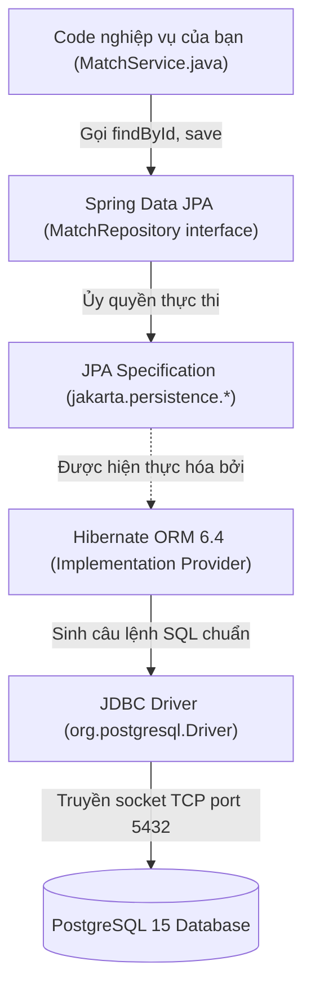
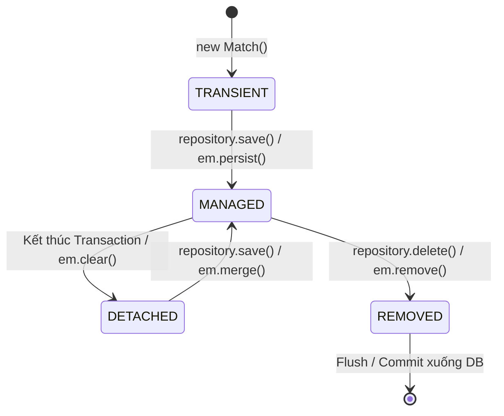

# GIÁO TRÌNH MENTOR THỰC CHIẾN: LÀM CHỦ SPRING DATA JPA & HIBERNATE QUA DỰ ÁN PBL6 BADMINTON

> **Mục tiêu tài liệu:** Giúp bạn nắm vững từ gốc rễ cách Spring Boot 3 tương tác với Cơ sở dữ liệu PostgreSQL 15: bản chất của ORM/Hibernate, quản lý vòng đời thực thể, cơ chế tự động sinh SQL, phân trang tối ưu, xử lý JSONB, và cách giải quyết các "cái bẫy" kinh điển như **Lỗi N+1 Query** hay **Stale Cache khi chạy Bulk Update**.

---

## MỤC LỤC
1. [Chương 1: Nguồn gốc & Bản chất ORM (Object-Relational Mapping)](#chương-1-nguồn-gốc--bản-chất-orm-object-relational-mapping)
2. [Chương 2: Thiết kế Thực thể (Entity Modeling) & Ánh xạ CSDL](#chương-2-thiết-kế-thực-thể-entity-modeling--ánh-xạ-csdl)
3. [Chương 3: Vòng đời Thực thể (Entity Lifecycle) & Persistence Context](#chương-3-vòng-đời-thực-thể-entity-lifecycle--persistence-context)
4. [Chương 4: Làm chủ 4 kỹ thuật Truy vấn trong Spring Data JPA](#chương-4-làm-chủ-4-kỹ-thuật-truy-vấn-trong-spring-data-jpa)
5. [Chương 5: Hiểm họa Hiệu năng: Lỗi N+1 Query & Cách khắc phục](#chương-5-hiểm-họa-hiệu-năng-lỗi-n1-query--cách-khắc-phục)
6. [Chương 6: Cơ chế Xóa mềm (Soft Delete) & Database Migration với Flyway](#chương-6-cơ-chế-xóa-mềm-soft-delete--database-migration-với-flyway)
7. [Chương 7: Bộ 10 câu hỏi vấn đáp Hội đồng phản biện về Spring Data JPA](#chương-7-bộ-10-câu-hỏi-vấn-đáp-hội-đồng-phản-biện-về-spring-data-jpa)

---

## CHƯƠNG 1: NGUỒN GỐC & BẢN CHẤT ORM (OBJECT-RELATIONAL MAPPING)

### 1.1. Lịch sử: Xung đột bất biến giữa OOP và RDBMS (Object-Relational Impedance Mismatch)
Trong công nghệ phần mềm tồn tại một khoảng cách rất lớn giữa hai thế giới:
* **Thế giới Hướng Đối Tượng (OOP - Java):** Dữ liệu được biểu diễn dưới dạng các Đối tượng (`Objects`), có các mối quan hệ đa hình, kế thừa, tham chiếu lồng nhau (`match.getOwner().getFullName()`), và đóng gói hành vi.
* **Thế giới Cơ Sở Dữ Liệu Quan Hệ (RDBMS - PostgreSQL):** Dữ liệu được tổ chức dưới dạng các Bảng (`Tables`) 2 chiều gồm hàng và cột, quan hệ thông qua Khóa chính (Primary Key) và Khóa ngoại (Foreign Key).

#### Nếu không có JPA/Hibernate: Nỗi cực hình của Raw JDBC
Trước đây, để lấy một trận đấu kèm thông tin người sở hữu, lập trình viên phải viết hàng chục dòng mã boilerplate lặp đi lặp lại:
```java
// === NẾU KHÔNG CÓ JPA: VIẾT RAW JDBC CỔ ĐIỂN ===
String sql = "SELECT m.id, m.player_a_name, m.player_b_name, u.id AS u_id, u.email " +
             "FROM matches m JOIN users u ON m.owner_id = u.id WHERE m.id = ?";
try (Connection conn = dataSource.getConnection();
     PreparedStatement ps = conn.prepareStatement(sql)) {
    ps.setLong(1, matchId);
    try (ResultSet rs = ps.executeQuery()) {
        if (rs.next()) {
            User user = new User();
            user.setId(rs.getLong("u_id"));
            user.setEmail(rs.getString("email"));

            Match match = new Match();
            match.setId(rs.getLong("id"));
            match.setPlayerAName(rs.getString("player_a_name"));
            match.setPlayerBName(rs.getString("player_b_name"));
            match.setOwner(user); // Tự gán bằng tay từng trường
            return match;
        }
    }
}
```
**Nhược điểm:**
1. Nếu bảng `matches` có 30 cột $\rightarrow$ Phải viết 30 dòng `rs.get...()`. Nếu đổi tên 1 cột trong database, code Java bị gãy ngay ở runtime mà compiler không hề cảnh báo!
2. Phải viết SQL riêng cho từng hệ quản trị: Cú pháp phân trang của PostgreSQL (`LIMIT / OFFSET`) khác MySQL và khác Oracle (`ROWNUM`). Muốn đổi CSDL là phải viết lại toàn bộ mã SQL.

### 1.2. Phân biệt rõ: JPA vs Hibernate vs Spring Data JPA
Đây là câu hỏi 90% sinh viên bị nhầm lẫn khi bảo vệ:

| Khái niệm | Bản chất | Vai trò trong dự án |
| :--- | :--- | :--- |
| **JPA (Jakarta Persistence API)** | **Đặc tả tiêu chuẩn (Specification / Interface)** | Chỉ là tập hợp các interface và annotation (`@Entity`, `@Table`, `EntityManager`, `@Id`). JPA **không có mã thực thi**. |
| **Hibernate** | **Bộ máy triển khai thực tế (Implementation / Provider)** | Là thư viện hiện thực hóa các interface của JPA. Hibernate chịu trách nhiệm đọc metadata, tự động dịch các thao tác Java thành câu lệnh SQL gửi xuống PostgreSQL. |
| **Spring Data JPA** | **Khung trừu tượng cấp cao (Abstraction Layer)** | Là tầng thư viện của Spring bọc bên ngoài JPA/Hibernate, cung cấp sẵn các Interface như `JpaRepository`, giúp bạn không cần viết code cho `EntityManager` mà chỉ cần khai báo tên method là Spring tự sinh câu truy vấn. |



---

## CHƯƠNG 2: THIẾT KẾ THỰC THỂ (ENTITY MODELING) & ÁNH XẠ CSDL

### 2.1. Phân tích chi tiết Entity [`Match.java`](file:///d:/DUT/HK1_Nam4_2026-2027/PBL6/PBL6_code/backend/src/main/java/com/badminton/entity/Match.java)
Hãy cùng mổ xẻ từng dòng code trong entity cốt lõi của dự án:

```java
package com.badminton.entity;

import jakarta.persistence.*;
import lombok.*;
import org.hibernate.annotations.CreationTimestamp;
import org.hibernate.annotations.UpdateTimestamp;
import java.time.LocalDate;
import java.time.OffsetDateTime;

@Entity                                   // [1] Khai báo class này ánh xạ tới 1 bảng trong CSDL
@Table(name = "matches")                  // [2] Tên bảng chính xác trong PostgreSQL
@Getter @Setter                           // [3] Lombok sinh getter/setter tự động
@NoArgsConstructor @AllArgsConstructor    // [4] Bắt buộc có constructor không tham số cho Hibernate Reflection
@Builder                                  // [5] Thiết kế khởi tạo theo Builder Pattern
public class Match {

    @Id                                                         // [6] Đánh dấu Khóa chính (Primary Key)
    @GeneratedValue(strategy = GenerationType.IDENTITY)         // [7] Chiến lược sinh ID tự tăng trong PostgreSQL
    private Long id;

    @ManyToOne(fetch = FetchType.LAZY)                          // [8] Quan hệ Nhiều-Một, tải lười (Lazy)
    @JoinColumn(name = "owner_id", nullable = false)           // [9] Tên cột Khóa ngoại tham chiếu bảng users
    private User owner;

    @Column(name = "player_a_name", nullable = false, length = 100) // [10] Ràng buộc cột NOT NULL, độ dài 100
    private String playerAName;

    @Column(name = "upper_player", nullable = false, length = 20)
    @Builder.Default                                            // [11] Giữ giá trị mặc định khi dùng Builder
    private String upperPlayer = "PLAYER_A";

    @Column(columnDefinition = "TEXT")                          // [12] Ép kiểu dữ liệu sang kiểu TEXT không giới hạn ký tự
    private String description;

    @Column(name = "deleted_at")                                // [13] Cột phục vụ Soft Delete (Xóa mềm)
    private OffsetDateTime deletedAt;

    @CreationTimestamp                                          // [14] Tự động gán thời gian hiện tại khi INSERT
    @Column(name = "created_at", nullable = false, updatable = false)
    private OffsetDateTime createdAt;

    @UpdateTimestamp                                            // [15] Tự động cập nhật thời gian hiện tại mỗi khi UPDATE
    @Column(name = "updated_at", nullable = false)
    private OffsetDateTime updatedAt;
}
```

#### Các điểm then chốt cần ghi nhớ:
* **Tại sao dùng `GenerationType.IDENTITY` thay vì `AUTO` hay `SEQUENCE`?**  
  Trong PostgreSQL, cột `id BIGSERIAL` là kiểu tự tăng cục bộ gắn với bảng. `IDENTITY` báo cho Hibernate tận dụng cơ chế `BIGSERIAL` (hoặc `IDENTITY` chuẩn SQL) của PostgreSQL để sinh ID tự tăng, tránh việc Hibernate tự tạo bảng phụ `hibernate_sequence` gây giảm hiệu năng.
* **Tại sao luôn đặt `FetchType.LAZY` trên `@ManyToOne`?**  
  Mặc định trong chuẩn JPA, `@ManyToOne` có `fetch = FetchType.EAGER` (tải tham lam). Nghĩa là mỗi khi bạn truy vấn 1 trận đấu, Hibernate sẽ tự động ép câu lệnh `LEFT JOIN users` để lấy toàn bộ thông tin User dù bạn có cần hay không. Đặt `FetchType.LAZY` giúp Hibernate chỉ tải bảng `matches`, khi nào bạn gọi `match.getOwner()` thì Hibernate mới phát lệnh query thêm, giúp tiết kiệm bộ nhớ và băng thông.

---

### 2.2. Xử lý Kiểu dữ liệu Phức tạp: Ánh xạ PostgreSQL `JSONB` trong Spring Boot 3 ([`AiAnalysis.java`](file:///d:/DUT/HK1_Nam4_2026-2027/PBL6/PBL6_code/backend/src/main/java/com/badminton/entity/AiAnalysis.java#L58-L80))

Trong hệ thống phân tích cầu lông, mô hình AI trả về các cây dữ liệu phân tích chiến thuật, radar chart và tọa độ rất phức tạp:
```json
{
  "attack": 85.5,
  "defense": 78.0,
  "net_control": 92.0,
  "pace": 88.5
}
```
Nếu thiết kế theo chuẩn CSDL truyền thống (phân rã ra 4-5 bảng quan hệ), khi truy vấn bạn phải JOIN rất nhiều bảng khiến tốc độ đọc chậm đi hàng chục lần. Thay vào đó, PostgreSQL cung cấp kiểu dữ liệu **`JSONB`** (JSON dạng nhị phân, có hỗ trợ đánh chỉ mục GIN).

**Cách Spring Boot 3 + Hibernate 6 xử lý JSONB nguyên bản cực kỳ thanh lịch:**
```java
@Entity
@Table(name = "ai_analyses")
public class AiAnalysis {

    // Trong Hibernate 6 (Spring Boot 3), chỉ cần dùng @JdbcTypeCode(SqlTypes.JSON)
    // Hibernate sẽ tự động biến chuỗi JSON thành kiểu jsonb nguyên bản của PostgreSQL!
    @JdbcTypeCode(SqlTypes.JSON)
    @Column(name = "radar_chart", columnDefinition = "jsonb")
    private String radarChart;

    @JdbcTypeCode(SqlTypes.JSON)
    @Column(name = "court_corners", columnDefinition = "jsonb")
    private String courtCorners;
}
```

---

## CHƯƠNG 3: VÒNG ĐỜI THỰC THỂ (ENTITY LIFECYCLE) & PERSISTENCE CONTEXT

Một thực thể trong JPA không đơn thuần là một class Java thông thường, nó được quản lý thông qua **Persistence Context** (Bộ nhớ đệm cấp 1 - First Level Cache) theo 4 trạng thái:



### 3.1. Bốn trạng thái vòng đời của Entity
1. **Transient (Mới tạo):** Đối tượng được khởi tạo bằng từ khóa `new` (ví dụ `Match match = new Match();`). CSDL chưa hề biết đến đối tượng này, `match.getId()` vẫn là `null`.
2. **Managed (Được quản lý):** Khi bạn gọi `matchRepository.save(match)`. Đối tượng đã có ID và nằm bên trong **Persistence Context**. Mọi thay đổi trên đối tượng này (ví dụ `match.setStatus("READY")`) sẽ được Hibernate ghi nhớ.
3. **Detached (Tách rời):** Khi transaction kết thúc (ra khỏi hàm `@Transactional`). Đối tượng vẫn tồn tại trong RAM của Java, có ID, nhưng những thay đổi sau đó trên đối tượng sẽ **không tự động đồng bộ xuống CSDL** nữa.
4. **Removed (Đánh dấu xóa):** Đối tượng bị gọi `delete()`, sẽ bị xóa khỏi DB khi transaction commit.

### 3.2. Cơ chế Tự Động Đồng Bộ Dữ Liệu (Dirty Checking)
Rất nhiều bạn thắc mắc: *"Tại sao trong code cập nhật trận đấu, em chỉ gọi `match.setTitle(...)` mà không gọi `matchRepository.save(match)`, nhưng dữ liệu trong DB vẫn tự động thay đổi?"*

Đó chính là nhờ **Dirty Checking**:
- Khi bắt đầu một method `@Transactional`, Hibernate tạo một snapshot (ảnh chụp trạng thái ban đầu) của Entity.
- Khi kết thúc method, trước khi COMMIT, Hibernate tự động so sánh trạng thái hiện tại của Entity với snapshot ban đầu.
- Nếu phát hiện có trường bị thay đổi (bị "dơ" - dirty), Hibernate sẽ **tự động sinh câu lệnh SQL `UPDATE matches SET title = ? ...` và thực thi xuống PostgreSQL** mà bạn không cần phải gõ lệnh `save()` bằng tay.

### 3.3. So sánh chuẩn xác: `save()` vs `saveAndFlush()`

| Đặc điểm | `repository.save(entity)` | `repository.saveAndFlush(entity)` |
| :--- | :--- | :--- |
| **Hành vi** | Đưa entity vào Persistence Context. Câu lệnh SQL INSERT/UPDATE **được giữ lại trong bộ đệm** và thường chỉ gửi xuống DB khi Transaction sắp kết thúc (Write-behind optimization). | Đưa entity vào Persistence Context và **ép buộc Hibernate gửi ngay lập tức câu lệnh SQL xuống CSDL** ngay tại dòng lệnh đó. |
| **Ứng dụng trong dự án** | Dùng cho các thao tác thông thường (Tạo trận đấu, đổi tên, update user). | Dùng trong [`AnalysisService.java`](file:///d:/DUT/HK1_Nam4_2026-2027/PBL6/PBL6_code/backend/src/main/java/com/badminton/service/AnalysisService.java#L72): Khi tạo phiên AI mới, ta cần câu lệnh INSERT chạy ngay xuống DB để lấy ID phiên gửi sang RabbitMQ cho Worker xử lý. |

---

## CHƯƠNG 4: LÀM CHỦ 4 KỸ THUẬT TRUY VẤN TRONG SPRING DATA JPA

Trong dự án PBL6 Badminton, hệ thống áp dụng đầy đủ 4 kỹ thuật truy vấn từ cơ bản đến chuyên sâu:

### 4.1. Kỹ thuật 1: Derived Query Methods (Tự động sinh SQL từ tên hàm)
Spring Data JPA có khả năng phân tích cú pháp tên hàm (Method Name Parsing) và tự động dịch thành câu lệnh SQL:

```java
// Trong MatchRepository.java:
Page<Match> findByOwnerIdAndDeletedAtIsNullOrderByCreatedAtDesc(Long ownerId, Pageable pageable);
```
**Hibernate sẽ tự động phân tích và sinh ra câu lệnh SQL PostgreSQL:**
```sql
SELECT * FROM matches 
WHERE owner_id = ? AND deleted_at IS NULL 
ORDER BY created_at DESC 
LIMIT 10 OFFSET 0;
```
* **Ưu điểm:** Cực nhanh, không cần viết một dòng SQL nào, an toàn trước lỗi chính tả cột.
* **Nhược điểm:** Tên hàm sẽ rất dài nếu có từ 3-4 điều kiện trở lên.

---

### 4.2. Kỹ thuật 2: Truy vấn Hướng Đối Tượng với JPQL (`@Query`)
Khi câu truy vấn phức tạp (tìm kiếm nhiều từ khóa, nối bảng), ta sử dụng **JPQL (Java Persistence Query Language)**:
```java
// Trong MatchRepository.java:
@Query("SELECT m FROM Match m WHERE m.status = 'PUBLISHED' AND m.deletedAt IS NULL AND " +
       "(LOWER(m.playerAName) LIKE LOWER(CONCAT('%', :kw, '%')) OR " +
       " LOWER(m.playerBName) LIKE LOWER(CONCAT('%', :kw, '%')) OR " +
       " LOWER(m.title) LIKE LOWER(CONCAT('%', :kw, '%')))")
Page<Match> searchPublicMatches(@Param("kw") String keyword, Pageable pageable);
```
* **Lưu ý quan trọng:** Trong câu lệnh trên, `Match` là **tên Class Java**, `m.playerAName` là **tên thuộc tính Java**, không phải tên bảng hay tên cột trong CSDL. Hibernate sẽ chịu trách nhiệm dịch JPQL này sang SQL tương thích với PostgreSQL.

---

### 4.3. Kỹ thuật 3: Bulk Update/Delete với `@Modifying`
Khi cần cập nhật hàng loạt bản ghi trực tiếp trong CSDL mà không muốn tải hàng ngàn Entity lên RAM Java rồi lặp qua từng phần tử để `save()`, ta dùng `@Modifying`:

```java
// Trong AiAnalysisRepository.java:
@Modifying(clearAutomatically = true, flushAutomatically = true)
@Query("UPDATE AiAnalysis a SET a.isCurrent = false WHERE a.match.id = :matchId")
void demoteAllCurrentByMatchId(@Param("matchId") Long matchId);
```

> **Câu hỏi "bẫy" kinh điển của Giảng viên:**  
> *"Tại sao ở hàm `demoteAllCurrentByMatchId` em lại phải đặt `clearAutomatically = true` và `flushAutomatically = true`?"*  
> **Bạn trả lời:**  
> *"Dạ thưa Thầy/Cô, câu lệnh `@Modifying UPDATE` sẽ gửi lệnh UPDATE trực tiếp xuống PostgreSQL mà **đi vòng qua Persistence Context (First-Level Cache)**.  
> Nếu không có `clearAutomatically = true`, các Entity `AiAnalysis` đang nằm trong bộ nhớ RAM của Hibernate vẫn giữ nguyên giá trị cũ (`isCurrent = true`). Khi các đoạn code phía sau truy vấn lại Entity này, Hibernate sẽ lấy dữ liệu rác từ Cache ra thay vì đọc từ DB.  
> Việc đặt `clearAutomatically = true` sẽ xóa sạch Persistence Context ngay sau lệnh Update, ép buộc các câu truy vấn tiếp theo phải lấy dữ liệu tươi mới nhất từ CSDL!"*

---

### 4.4. Kỹ thuật 4: Phân trang & Sắp xếp Tối ưu (Pagination & Sorting)
Tại các API xem danh sách ([`MatchController.java`](file:///d:/DUT/HK1_Nam4_2026-2027/PBL6/PBL6_code/backend/src/main/java/com/badminton/controller/MatchController.java#L33-L41)), ta luôn truyền đối tượng `Pageable`:

```java
Pageable pageable = PageRequest.of(page, size, Sort.by("createdAt").descending());
Page<Match> matchPage = matchRepository.findByOwnerIdAndDeletedAtIsNull(userId, pageable);
```

#### Phân biệt `Page<T>` vs `Slice<T>` vs `List<T>`:
1. **`List<T>`:** Lấy toàn bộ bản ghi. Nếu CSDL có 1 triệu trận đấu, server sẽ bị tràn bộ nhớ (Out Of Memory - OOM) và sập ứng dụng ngay lập tức.
2. **`Page<T>`:** Trả về dữ liệu trang hiện tại + **tự động sinh thêm 1 câu lệnh `SELECT COUNT(*)`** để tính tổng số trang, tổng số bản ghi (phù hợp cho giao diện có số trang cụ thể `1, 2, 3... Trang cuối`).
3. **`Slice<T>`:** Chỉ lấy thêm 1 bản ghi dư (`size + 1`) để biết có còn trang sau hay không, **không chạy lệnh `COUNT(*)`** $\rightarrow$ Tối ưu hiệu năng vượt trội cho tính năng cuộn vô tận (Infinite Scroll trên Mobile/Web).

---

## CHƯƠNG 5: HIỂM HỌA HIỆU NĂNG: LỖI N+1 QUERY & CÁCH KHẮC PHỤC

### 5.1. Lỗi N+1 Query là gì?
Giả sử bạn cần lấy danh sách 10 trận đấu và hiển thị tên người tạo:
```java
List<Match> matches = matchRepository.findAll(); // 1 câu query lấy 10 matches
for (Match m : matches) {
    System.out.println(m.getOwner().getFullName()); // N câu query lấy User cho từng match!
}
```
* **Hậu quả:** Để lấy 10 trận đấu, hệ thống phải phát ra **1 + 10 = 11 câu lệnh query** xuống CSDL! Nếu lấy 1.000 trận đấu, hệ thống sẽ bắn **1.001 câu truy vấn**, làm nghẽn kết nối và sập database.

### 5.2. Cách giải quyết triệt để bằng `JOIN FETCH`
Thay vì để Hibernate query lười từng dòng, ta dùng từ khóa `JOIN FETCH` trong JPQL để yêu cầu lấy luôn cả bảng liên kết trong **duy nhất 1 câu lệnh SQL**:
```java
@Query("SELECT m FROM Match m JOIN FETCH m.owner WHERE m.status = 'PUBLISHED' AND m.deletedAt IS NULL")
List<Match> findAllWithUserEagerly();
```
**Câu lệnh SQL duy nhất được sinh ra:**
```sql
SELECT m.*, u.* FROM matches m 
INNER JOIN users u ON m.owner_id = u.id 
WHERE m.status = 'PUBLISHED' AND m.deleted_at IS NULL;
```
$\rightarrow$ Số câu truy vấn giảm từ $N+1$ xuống còn **chính xác 1 câu duy nhất**!

---

## CHƯƠNG 6: CƠ CHẾ XÓA MỀM (SOFT DELETE) & DATABASE MIGRATION VỚI FLYWAY

### 6.1. Tại sao không bao giờ dùng `DELETE FROM matches`? (Soft Delete)
Trong các hệ thống thực tế:
1. **Tính toàn vẹn dữ liệu:** Nếu bạn xóa cứng (`Hard Delete`) 1 trận đấu, các bảng liên quan như `videos`, `ai_analyses`, `ai_events`, `rallies` sẽ bị xóa dây chuyền hoặc gãy khóa ngoại.
2. **Bảo vệ người dùng:** Nếu người dùng bấm nhầm nút Xóa, ta hoàn toàn có thể khôi phục lại từ Thùng rác.
3. **Pháp lý & Thống kê:** Cần lưu lại lịch sử dữ liệu để làm báo cáo tài chính hoặc kiểm tra vi phạm.

#### Triển khai Soft Delete trong dự án:
* Trong Entity `Match`: Khai báo trường `private OffsetDateTime deletedAt;`.
* Khi xóa ([`MatchService.java`](file:///d:/DUT/HK1_Nam4_2026-2027/PBL6/PBL6_code/backend/src/main/java/com/badminton/service/MatchService.java#L110-L125)):
  ```java
  match.setDeletedAt(OffsetDateTime.now());
  matchRepository.save(match);
  ```
* Mọi câu query lấy dữ liệu đều gắn điều kiện: `deletedAt IS NULL`.
* Quản trị viên khôi phục ([`VS-16`](file:///d:/DUT/HK1_Nam4_2026-2027/PBL6/PBL6_code/backend/src/main/java/com/badminton/controller/admin/AdminMatchController.java)): Chỉ cần đặt `match.setDeletedAt(null);`.

---

### 6.2. Quản lý Phiên bản CSDL với Flyway (Database Migration)

> **Cảnh báo sống còn:** Trên môi trường Production, **tuyệt đối không bao giờ** được bật `spring.jpa.hibernate.ddl-auto=update`. Nếu Hibernate tự động phân tích và sửa cột, nó có thể làm mất dữ liệu của khách hàng hoặc khóa chặt các bảng lớn.

Dự án PBL6 Badminton sử dụng **Flyway** để quản lý lịch sử CSDL:
* Mọi thay đổi schema đều được viết dưới dạng các file SQL có phiên bản trong thư mục `src/main/resources/db/migration/`:
  - [`V1__init_schema.sql`](file:///d:/DUT/HK1_Nam4_2026-2027/PBL6/PBL6_code/backend/src/main/resources/db/migration/V1__init_schema.sql): Khởi tạo 9 bảng nền tảng, khóa chính, khóa ngoại, check constraints.
  - [`V2__align_ai_schema.sql`](file:///d:/DUT/HK1_Nam4_2026-2027/PBL6/PBL6_code/backend/src/main/resources/db/migration/V2__align_ai_schema.sql): Bổ sung các trường phân tích chiến thuật, góc đánh 3x3 và kiểu dữ liệu JSONB cho pipeline CoachAI+ 2.0.
  - [`V3__add_youtube_video_support.sql`](file:///d:/DUT/HK1_Nam4_2026-2027/PBL6/PBL6_code/backend/src/main/resources/db/migration/V3__add_youtube_video_support.sql): Bổ sung hỗ trợ nguồn video YouTube và Partial Indexes tối ưu tìm kiếm công khai.
* Khi container Backend khởi động, Flyway tự kiểm tra bảng quản lý `flyway_schema_history` trong PostgreSQL: File migration nào chưa chạy sẽ được thực thi tuần tự theo đúng thứ tự phiên bản $V1 \rightarrow V2 \rightarrow V3$.

---

## CHƯƠNG 7: BỘ 10 CÂU HỎI VẤN ĐÁP HỘI ĐỒNG PHẢN BIỆN VỀ SPRING DATA JPA

### Câu 1: Em hãy giải thích sự khác nhau giữa `FetchType.LAZY` và `FetchType.EAGER`?
* **Trả lời:**  
  *"Dạ thưa Thầy/Cô:  
  - `EAGER` (Tải sớm/tham lam): Khi câu truy vấn thực thể cha được thực hiện, Hibernate sẽ tự động JOIN để tải luôn toàn bộ các thực thể con liên quan, bất kể ta có dùng đến chúng hay không.  
  - `LAZY` (Tải lười/chậm): Khi truy vấn thực thể cha, Hibernate chỉ tải dữ liệu của cha và đặt một đối tượng ảo (Hibernate Proxy) vào vị trí của con. Chỉ khi nào mã nguồn gọi method `get...()` trên đối tượng con trong phạm vi một session/transaction còn mở, Hibernate mới bắn tiếp câu query thứ hai để lấy dữ liệu con.  
  Trong dự án, em luôn ưu tiên dùng `FetchType.LAZY` trên các quan hệ `@ManyToOne` để kiểm soát chặt chẽ câu lệnh SQL và tối ưu hóa bộ nhớ."*

### Câu 2: Lỗi `LazyInitializationException` xảy ra khi nào và em khắc phục như thế nào?
* **Trả lời:**  
  *"Dạ, lỗi này xảy ra khi ta truy cập vào một thuộc tính `LAZY` sau khi Session/Transaction của Hibernate đã bị đóng (ngoài phạm vi `@Transactional`, ví dụ chuyển dữ liệu sang DTO ở tầng Controller hoặc ra ngoài View). Lúc này Proxy không còn kết nối CSDL để nạp dữ liệu nữa nên ném ra `LazyInitializationException: could not initialize proxy - no Session`.  
  Cách khắc phục chuẩn nhất mà em áp dụng là: Sử dụng `JOIN FETCH` trong JPQL hoặc `@EntityGraph` ngay tại tầng Repository để nạp sẵn dữ liệu cần thiết bên trong Service trước khi đóng transaction."*

### Câu 3: Làm thế nào để lưu một danh sách hàng ngàn sự kiện cú đánh (`ai_events`) mà không làm sập CSDL?
* **Trả lời:**  
  *"Dạ, nếu lặp vòng for gọi `repository.save()` cho 1.000 sự kiện cú đánh, Hibernate sẽ phát 1.000 câu lệnh INSERT riêng lẻ gây nghẽn kết nối mạng.  
  Để tối ưu, ta phải bật tính năng **JDBC Batching** trong `application.properties`:
  `spring.jpa.properties.hibernate.jdbc.batch_size=50`
  Và gọi `saveAll(eventList)`. Khi đó Hibernate sẽ gom các câu lệnh INSERT lại thành các gói lô (Batch) 50 bản ghi gửi xuống PostgreSQL trong 1 lần round-trip, tăng tốc độ ghi dữ liệu lên gấp 10-20 lần."*

### Câu 4: Sự khác biệt giữa `findTopByMatchIdOrderByCreatedAtDesc` và `findByMatchId` là gì?
* **Trả lời:**  
  *"Dạ:  
  - `findByMatchId`: Trả về toàn bộ danh sách các bản ghi khớp với `matchId`.  
  - `findTopByMatchIdOrderByCreatedAtDesc`: Spring Data JPA tự động dịch thành câu lệnh SQL có mệnh đề `LIMIT 1` sau khi sắp xếp giảm dần theo thời gian tạo, trả về duy nhất 1 bản ghi mới nhất dưới dạng `Optional<T>`, giúp ta không phải tải toàn bộ danh sách về Java rồi tự lọc phần tử đầu tiên."*

### Câu 5: Tại sao em không dùng `@GeneratedValue(strategy = GenerationType.AUTO)`?
* **Trả lời:**  
  *"Dạ, `AUTO` giao toàn quyền quyết định chiến lược sinh khóa chính cho Hibernate tùy theo loại CSDL. Trong các phiên bản Hibernate trước, khi dùng PostgreSQL với `AUTO`, Hibernate thường mặc định sinh ra một sequence chung toàn cục (`hibernate_sequence`) dùng cho mọi bảng trong DB, gây ra hiện tượng cạnh tranh khóa (lock contention) khi nhiều bảng cùng ghi dữ liệu. Do đó, việc chỉ định tường minh `GenerationType.IDENTITY` gắn chặt với cơ chế `BIGSERIAL` riêng biệt của từng bảng là tối ưu và an toàn nhất."*

### Câu 6: Trong Entity của em có trường `deletedAt`. Tại sao ở PostgreSQL em lại tạo `Partial Index` trên trường này?
* **Trả lời:**  
  *"Dạ, đây là kỹ thuật tối ưu hóa chỉ mục theo yêu cầu **NFR-PER-01**:  
  Trong bảng `matches`, 95% dữ liệu là các trận đấu đang hoạt động (`deleted_at IS NULL`), chỉ một số ít nằm trong Thùng rác.  
  Trong file [`V1__init_schema.sql`](file:///d:/DUT/HK1_Nam4_2026-2027/PBL6/PBL6_code/backend/src/main/resources/db/migration/V1__init_schema.sql#L202), em tạo chỉ mục:  
  `CREATE INDEX idx_matches_owner_active ON matches(owner_id, created_at DESC) WHERE deleted_at IS NULL;`  
  Từ khóa `WHERE deleted_at IS NULL` tạo ra một **Partial Index (Chỉ mục từng phần)**: PostgreSQL chỉ lập chỉ mục cho các bản ghi chưa bị xóa, giúp cây chỉ mục B-Tree cực kỳ nhỏ gọn, vừa vặn trong RAM và tốc độ tìm kiếm nhanh hơn nhiều so với chỉ mục thông thường."*

### Câu 7: Cơ chế Dirty Checking phát hiện thay đổi trên đối tượng như thế nào?
* **Trả lời:**  
  *"Dạ, khi một Entity được nạp vào Persistence Context, Hibernate sẽ lưu trữ một bản sao nhị phân (Snapshot) của Entity đó. Trong quá trình Transaction diễn ra, Hibernate không giám sát từng lệnh setter. Nhưng ngay trước khi câu lệnh SQL tiếp theo được flush hoặc trước khi Transaction commit, Hibernate thực hiện một bước so sánh đối chiếu (State Comparison) giữa đối tượng thực tế và bản Snapshot ban đầu. Nếu có bất kỳ trường nào khác biệt, Hibernate sẽ đưa câu lệnh UPDATE tương ứng vào hàng đợi hành động (Action Queue) để thực thi xuống DB."*

### Câu 8: Tại sao lại cần DTO (Data Transfer Object) mà không trả trực tiếp Entity ra ngoài Controller?
* **Trả lời:**  
  *"Dạ, việc trả trực tiếp Entity ra Controller là một lỗ hổng thiết kế nghiêm trọng vì 3 lý do:  
  1. **Bảo mật:** Entity chứa các thông tin nhạy cảm như `passwordHash`, token bí mật. Trả thẳng Entity rất dễ làm lộ dữ liệu.  
  2. **Vòng lặp vô tận (Infinite JSON Recursion):** Nếu Entity A tham chiếu Entity B và Entity B tham chiếu ngược lại Entity A (quan hệ hai chiều), thư viện chuyển đổi JSON Jackson sẽ bị lặp vô tận dẫn đến lỗi `StackOverflowError`.  
  3. **Tách biệt kiến trúc:** Thay đổi cấu trúc bảng CSDL không được phép làm thay đổi cấu trúc API trả về cho Frontend. DTO đóng vai trò là một hợp đồng dữ liệu độc lập (API Contract)."*

### Câu 9: Trong Spring Data JPA, `Optional<T>` giúp giải quyết vấn đề gì?
* **Trả lời:**  
  *"Dạ, trước Java 8, các hàm tìm kiếm như `findById` thường trả về `null` nếu không tìm thấy bản ghi. Lập trình viên nếu quên kiểm tra `if (match != null)` sẽ ngay lập tức gây ra lỗi kinh điển `NullPointerException` làm sập luồng xử lý.  
  Spring Data JPA trả về `Optional<T>` để ép buộc lập trình viên phải chủ động xử lý trường hợp không có dữ liệu bằng các hàm biểu cảm như `.orElseThrow(...)` hoặc `.ifPresent(...)`, giúp code an toàn và tường minh hơn."*

### Câu 10: Giả sử có hai giao dịch (Transactions) cùng cập nhật một trận đấu tại cùng một thời điểm, làm sao em chống xung đột dữ liệu?
* **Trả lời:**  
  *"Dạ, có hai kỹ thuật giải quyết:  
  1. **Pessimistic Locking (Khóa bi quan):** Dùng lệnh SQL `SELECT ... FOR UPDATE` (trong Spring Data JPA dùng annotation `@Lock(LockModeType.PESSIMISTIC_WRITE)`). Transaction đầu tiên sẽ khóa dòng đó lại, Transaction thứ hai bắt buộc phải chờ cho đến khi Transaction một kết thúc.  
  2. **Optimistic Locking (Khóa lạc quan):** Thêm trường `@Version private Long version;` vào Entity. Mỗi lần UPDATE, Hibernate kiểm tra số version trong DB: `UPDATE matches SET ..., version = version + 1 WHERE id = ? AND version = ?`. Nếu một transaction khác đã cập nhật trước, Hibernate sẽ ném ra `OptimisticLockException`, giúp ta phát hiện xung đột mà không cần khóa cứng CSDL."*

---

> 💡 **Lời khuyên thực chiến:** Hãy mở đồng thời file [Match.java](file:///d:/DUT/HK1_Nam4_2026-2027/PBL6/PBL6_code/backend/src/main/java/com/badminton/entity/Match.java), [MatchRepository.java](file:///d:/DUT/HK1_Nam4_2026-2027/PBL6/PBL6_code/backend/src/main/java/com/badminton/repository/MatchRepository.java) và [V1__init_schema.sql](file:///d:/DUT/HK1_Nam4_2026-2027/PBL6/PBL6_code/backend/src/main/resources/db/migration/V1__init_schema.sql) để kiểm chứng sự ánh xạ hoàn hảo giữa Code Java và Cơ sở dữ liệu PostgreSQL nhé!

